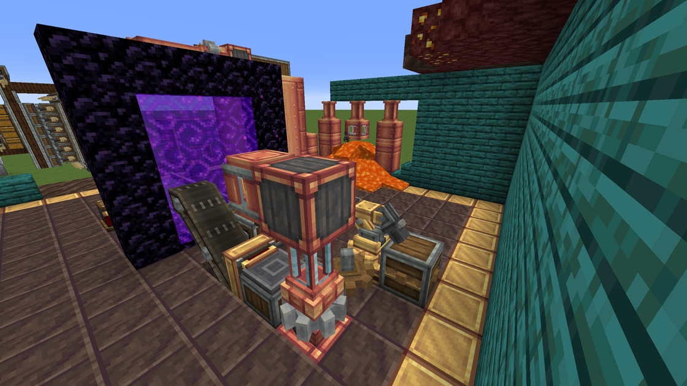
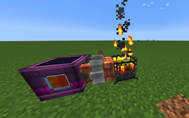
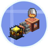

---
navigation:
  title: "Liquid fuels"
  position: 9
  parent: reference.machines-storage.md
  icon: minecraft:lava_bucket
---

# Liquid fuels

## Unified fuels

<EmiSearch query="@create" />

Create fluid tanks beside a Nether portal

Fluid supply to a Blaze Burner

Create: Unified Fuels connects supported fuel consumers through shared fuel groups and generated compatibility data. It adds no separate machine or item catalog. The selected release covers systems such as The Factory Must Grow, Crafts & Additions burners, Liquid Fuel and Stuff 'N Additions fueling tanks when the corresponding addon is present.

Fuel acceptance still depends on the consumer, fluid group and actual recipe. Refinery intermediates, process chemicals and steam are not automatically burnable fuel. Do not assume any fluid can power every engine or superheat every burner. Check the recipe browser before connecting a shared fuel supply.

- [Materials & fuels](power.industry.md)

***

## Burners & fluid supply

<ItemGrid>
  <ItemIcon id="create:blaze_burner" />
  <ItemIcon id="create:fluid_tank" />
  <ItemIcon id="create:fluid_pipe" />
  <ItemIcon id="create:mechanical_pump" />
  <ItemIcon id="minecraft:lava_bucket" />
</ItemGrid>

| Items & families | Use |
| --- | --- |
| <ItemLink id="create:blaze_burner" /> | Create Blaze Burner supplies heat. Create: Liquid Fuel extends this existing burner rather than adding a separate machine. |
| <ItemLink id="create:fluid_tank" />, <ItemLink id="create:fluid_pipe" />, <ItemLink id="create:mechanical_pump" /> | Tank, pipe and pump components provide fluid supply. |
| <ItemLink id="minecraft:lava_bucket" /> | The released liquid-fuel definition accepts lava for ordinary heat, not superheating. The bucket icon represents the fluid. |

***

## Getting started

### Empty burner

<Recipe id="create:crafting/kinetics/empty_blaze_burner" />

Craft <ItemLink id="create:empty_blaze_burner" /> first. It is not a captured <ItemLink id="create:blaze_burner" /> yet. Capture a blaze using the empty burner before supplying fuel.

Start with a captured Blaze Burner and inspect the lava supply route. Do not assume diesel, gasoline or every oil is accepted. Unified Fuels can add compatibility entries, but each consumer still has its own accepted fluids. Confirm the actual fluid in the item browser before plumbing a fuel line. Burner arrangement and heat states are covered by Create Ponder.

## Related topics

- [Browse recipe](help.search.md)

***

## Related mods

| Mod or content | Purpose | Item search |
| --- | --- | --- |
|  [Create: Liquid Fuel](power.burners.md) | Lets Create blaze burners consume pumped liquid fuel. | No separate item search |
| <ItemImage id="create:crushing_wheel" /> [Create: Unified Fuels](power.burners.md) | Connects supported Create fuel systems without adding a separate item catalog. | No separate item search |
