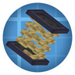

---
navigation:
  title: "Stored rotation"
  position: 4
  parent: reference.machines-storage.md
  icon: create:flywheel
---

# Stored rotation

 [English](https://www.youtube.com/results?search_query=Minecraft+1.21.1+Create+Springs+rotational+spring+kinetic+battery+tutorial) · [中文](https://www.youtube.com/results?search_query=Minecraft+1.21.1+Create+Springs+%E6%97%8B%E8%BD%AC%E5%BC%B9%E7%B0%A7+%E5%8A%A8%E5%8A%9B%E7%94%B5%E6%B1%A0+%E6%95%99%E7%A8%8B)

## Rotational reserves

<EmiSearch query="@create_connected" /> <EmiSearch query="@create" />

<ItemLink id="create_connected:kinetic_battery" /> stores stress capacity. Unpowered, it draws stress from the front input to charge. Redstone makes it discharge at its set capacity and speed. Its interface and comparator output show charge. Other kinetic sources meeting demand prevent battery discharge apart from the small belt transport cost documented in its Ponder.

| Part | View | Job |
| --- | --- | --- |
| <ItemLink id="create_connected:kinetic_battery" /> | <ItemGrid><ItemIcon id="create_connected:kinetic_battery" /></ItemGrid> | Stores and returns stress capacity |
| <ItemLink id="create_connected:kinetic_bridge" /> | <ItemGrid><ItemIcon id="create_connected:kinetic_bridge" /></ItemGrid> | Transfers capacity between separate networks |
| <ItemLink id="create:stressometer" /> | <ItemGrid><ItemIcon id="create:stressometer" /></ItemGrid> | Reads network stress |
| <ItemLink id="create:analog_lever" /> | <ItemGrid><ItemIcon id="create:analog_lever" /></ItemGrid> | Redstone control |

1. Connect an operating source to the battery front and leave it unpowered to charge.
2. Apply redstone to discharge. Compare the stored charge and network behavior.
3. To move charge between units, right-click a charging battery with another battery to discharge it, or right-click a discharging battery with a charged one to transfer charge. Deployers and mechanical arms automate this.

Batteries retain charge as items. Chain batteries to extend discharge duration. Connect them in parallel to raise total stress capacity. Actual drain follows the stress capacity in use, so do not treat the battery as a fixed-time supply.

***

## Springs store rotational force

<EmiSearch query="@createsprings" />

 [English](https://www.youtube.com/results?search_query=Minecraft+1.21.1+Create+Springs+1.2+spring+charging+large+spring+tools+tutorial) · [中文](https://www.youtube.com/results?search_query=%E6%88%91%E7%9A%84%E4%B8%96%E7%95%8C+1.21.1+Create+Springs+%E5%BC%B9%E7%B0%A7+%E5%85%85%E8%83%BD+%E5%A4%A7%E5%9E%8B%E5%BC%B9%E7%B0%A7+%E5%B7%A5%E5%85%B7+%E6%95%99%E7%A8%8B)

A spring stores rotational force. Either input direction charges it. Redstone releases the stored force, and signal strength controls output speed. Stiffness controls charging. The spring can switch between rotational output and splash mode with a Tripwire Hook, then return to rotational mode by using an empty hand.

| Spring system | View | Operation |
| --- | --- | --- |
| <ItemLink id="createsprings:spring" /> | <ItemGrid><ItemIcon id="createsprings:spring" /></ItemGrid> | Charges from rotation, redstone discharges |
| <ItemLink id="createsprings:large_spring_coil" /> | <ItemGrid><ItemIcon id="createsprings:large_spring_coil" /></ItemGrid> | Build a large spring from same-facing coils, a three by three end layer and hollow rings |
| <ItemLink id="createsprings:kinetic_interface" /> | <ItemGrid><ItemIcon id="createsprings:kinetic_interface" /></ItemGrid> | Paired interfaces with one-block gap interact with springs on a moving contraption |
| <ItemLink id="createsprings:spring_base" /> | <ItemGrid><ItemIcon id="createsprings:spring_base" /></ItemGrid> | Base for spring-powered tools |

| Spring device | View | Use |
| --- | --- | --- |
| <ItemLink id="createsprings:spring_catapult" /> | <ItemGrid><ItemIcon id="createsprings:spring_catapult" /></ItemGrid> | Select target before placement, insert items and supply rotation. Without a target it does nothing |
| <ItemLink id="createsprings:spring_drill" /> | <ItemGrid><ItemIcon id="createsprings:spring_drill" /></ItemGrid> | Spring-powered drilling tool |
| <ItemLink id="createsprings:spring_saw" /> | <ItemGrid><ItemIcon id="createsprings:spring_saw" /></ItemGrid> | Spring-powered cutting tool |
| <ItemLink id="createsprings:spring_shove" /> | <ItemGrid><ItemIcon id="createsprings:spring_shove" /></ItemGrid> | Spring-powered digging tool |
| <ItemLink id="createsprings:spring_fan" /> | <ItemGrid><ItemIcon id="createsprings:spring_fan" /></ItemGrid> | Spring-powered portable fan |
| <ItemLink id="createsprings:spring_launcher" /> | <ItemGrid><ItemIcon id="createsprings:spring_launcher" /></ItemGrid> | Launcher for spring items and blocks |
| <ItemLink id="createsprings:punchcard" /> | <ItemGrid><ItemIcon id="createsprings:punchcard" /></ItemGrid> | Programs supported tools |
| <ItemLink id="createsprings:portative_steam_engine" /> | <ItemGrid><ItemIcon id="createsprings:portative_steam_engine" /></ItemGrid> | Portable steam engine with fuel, water and pressure controls |

1. Attach a spring to an operating shaft without a redstone signal. Either rotational direction charges it. Apply redstone to release its stored rotation, using signal strength to choose output speed.
2. For a portable tool, stack charged springs onto its Spring Base or supported spring tool in the inventory. The base and drill, saw, shovel and fan each accept up to two springs. Mining or harvesting speed follows the tool's speed.
3. Sneak right click a Punchcard to open its instructions, select the executor and activation condition, then stack the card onto the compatible tool. It programs actions, not charge.
4. Sneak right click with the Spring Catapult to select a target before placing it. Then supply rotation and insert an item. No selected target means no launch.

The Portable Steam Engine opens its interface with its configured engine-interface key. Put furnace fuel in its fuel slot and carry a water bucket for replenishment. Its mode chooses the supported charging or tool-speed job. Overdrive increases pressure and the engine explodes at one hundred pressure, so watch its gauge rather than leaving overdrive enabled.

<ItemGrid><ItemIcon id="createsprings:friction_welder" /><ItemIcon id="createsprings:spring_alloy" /><ItemIcon id="createsprings:unfinished_spring" /></ItemGrid>

A Friction Welder processes blocks between two welders rotating with a speed difference. Use the recipe browser for the spring-alloy and unfinished-spring recipes rather than treating these materials as charged tools.

The punchcard configures supported tool instructions, not stored rotational force. The portable steam engine is a separate carried engine, not a spring. See [Rotational power](machines.rotation.md) for shafts and network stress.

***

## Related mods

| Mod or content | Purpose | Item search |
| --- | --- | --- |
|  [Create: Springs](power.stored-rotation.md) | Stores rotational energy in springs for later use. | <EmiSearch query="@createsprings" /> |
