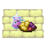
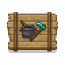
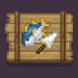
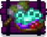
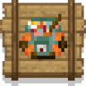
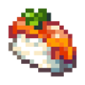

---
navigation:
  title: "Food & farming"
  position: 9
  icon: minecraft:bread
---

# Food & farming

 [English](https://www.youtube.com/results?search_query=Minecraft%201.21.1%20Farmer%27s%20Delight%20cooking%20pot%20first%20meal%20tutorial) · [中文](https://www.youtube.com/results?search_query=Minecraft%201.21.1%20%E5%86%9C%E5%A4%AB%E4%B9%90%E4%BA%8B%20%E7%83%B9%E9%A5%AA%E9%94%85%20%E7%AC%AC%E4%B8%80%E9%A4%90%20%E6%95%99%E7%A8%8B)

## Cooking tools

<EmiSearch query="@farmersdelight" />

- <ItemImage id="farmersdelight:flint_knife" /> [Cooking tools & meals](food.utensils.md) Start with a knife and a board, cook a pot meal on a campfire, then compare the skillet, the stove, feast servings and the food families.

## Meals and effects

- <ItemImage id="minecraft:apple" /> [Hunger & variety](food.hunger.md) Read hunger and saturation, use Comfort and Nourishment, keep the Food Book record growing and carry meals in a lunch container.

***

## Ingredients by region

<EmiSearch query="@hybrid_delights" /> <EmiSearch query="@oceansdelight" /> <EmiSearch query="@starcatcher" />

- <ItemImage id="minecraft:wheat" /> [Crop ingredients](food.growing.md) Wild crops, seeds, rice processing and harvesting helpers.
- <ItemImage id="oceansdelight:cooked_stuffed_squid" /> [Seafood](food.seafood.md) Starcatcher's Delight, Hybrid Delights and Ocean's Delight dishes.
- <ItemImage id="minecraft:crimson_fungus" /> [Nether foods](food.nether.md) Nether hunting and pepper ingredients for sausages, stews and ghast dough.
- <ItemImage id="minecraft:chorus_fruit" /> [End foods](food.end.md) Gathered chorus ingredients and knife cut shulker meat.
- <ItemImage id="minecraft:brown_mushroom" /> [Underground foods](food.underground.md) Cave crops, hunted ingredients and copper serving containers.
- <ItemImage id="minecraft:rotten_flesh" /> [Encounter foods](food.encounters.md) Cataclysm creature ingredients and the dishes built from them.

***

## Fishing

- <ItemImage id="starcatcher:starcatcher_rod" /> [Fishing](food.fishing.md) Craft the Starcatcher rod and guide, read a species entry, reel a catch and choose what to do with it.

Biome and fish location lookup belongs to Starcatcher's Guide, and the fishing page shows how to craft and read it.

***

## Bulk cooking

- <ItemImage id="minecraft:smoker" /> [Machine kitchens](food.machine-cooking.md) Slicing, drink fluids and crop production, for when one pot is not enough.

***

## Related mods

| Mod or content | Purpose | Item search |
| --- | --- | --- |
|  [AppleSkin](food.hunger.md) | Shows food hunger restoration and saturation in tooltips and the hunger display. | No separate item search |
|  [Create Slice & Dice](food.machine-cooking.md) | Adds Create machinery for automated Farmer's Delight food preparation. | <EmiSearch query="@sliceanddice" /> |
|  [Create: Central Kitchen](food.machine-cooking.md) | Connects other cooking mods to Create machines for automated food processing. | No separate item search |
|  [Create: Integrated Farming](food.growing.md) | Adds automatic crop harvesting, fishing nets and poultry production to Create. | <EmiSearch query="@create_integrated_farming" /> |
|  [End's Delight](food.end.md) | Adds End-themed ingredients and dishes to Farmer's Delight. | <EmiSearch query="@ends_delight" /> |
|  [Farmer's Delight](food.utensils.md) | Adds crops, cooking utensils and meal preparation with cutting boards and cooking pots. | <EmiSearch query="@farmersdelight" /> |
|  [Hybrid Aquatic + Starcatcher Compatibility](food.fishing.md) | Adds Hybrid Aquatic catches to Starcatcher fishing. | <EmiSearch query="@hybrid_aquatic" /> |
|  [Hybrid Delights](food.seafood.md) | Prepares Hybrid Aquatic ingredients with Farmer's Delight. | <EmiSearch query="@hybrid_delights" /> |
|  [L_Ender 's Cataclysm Delight](food.encounters.md) | Turns Cataclysm ingredients into Farmer's Delight-style dishes. | <EmiSearch query="@lendersdelight" /> |
|  [Leaves Be Gone](food.growing.md) | Makes unsupported leaves decay quickly after trees are cut. | No separate item search |
|  [Miner's Delight](food.underground.md) | Adds mining-themed food and cooking tools to Farmer's Delight. | <EmiSearch query="@minersdelight" /> |
|  [My Nether's Delight](food.nether.md) | Adds Nether crops, ingredients and cooking recipes to Farmer's Delight. | <EmiSearch query="@mynethersdelight" /> |
|  [Ocean's Delight](food.seafood.md) | Adds seafood dishes using ocean ingredients. | <EmiSearch query="@oceansdelight" /> |
|  [RightClickHarvest](food.growing.md) | Harvests mature crops with a right click instead of breaking and replanting manually. | No separate item search |
| <ItemImage id="minecraft:wheat" /> [Short Stacks](food.hunger.md) | Changes food stack limits to alter how much food fits in each inventory slot. | No separate item search |
|  [Smarter Farmers (farmers replant)](food.growing.md) | Helps farmer villagers replant the correct crops, including supported modded seeds. | No separate item search |
|  [Spice of Life Onion](food.hunger.md) | Rewards dietary variety using a rolling history of recently eaten foods. | <EmiSearch query="@solonion" /> |
|  [Starcatcher](food.fishing.md) | Adds habitat-dependent fishing, equipment and a fishing guide. | <EmiSearch query="@starcatcher" /> |
|  [Starcatcher's Delight - Let's Do: Kaleidoscope edition](food.seafood.md) | Adds dishes and preparation for Starcatcher catches. | <EmiSearch query="@starcatcher_delight" /> |
|  [Universal Bone Meal](food.growing.md) | Extends bone meal use to plants that normally do not accept it. | No separate item search |
