---
navigation:
  title: "Transport"
  position: 12
  icon: minecraft:minecart
---

# Transport

 [English](https://www.youtube.com/results?search_query=Minecraft+Create+transport+trains+airships+submarines+guide) · [中文](https://www.youtube.com/results?search_query=Minecraft+Create+%E4%BA%A4%E9%80%9A+%E5%88%97%E8%BD%A6+%E9%A3%9E%E8%89%87+%E6%BD%9C%E8%89%87+%E6%95%99%E7%A8%8B)

## Land and water

<EmiSearch query="@create_submarine" /> <EmiSearch query="@createrailwaysnavigator" /> <EmiSearch query="@create" /> <EmiSearch query="@create_hypertube" />

<ItemGrid><ItemIcon id="create_hypertube:hypertube" /><ItemIcon id="offroad:tire" /><ItemIcon id="createrailwaysnavigator:navigator" /><ItemIcon id="create:track" /><ItemIcon id="create_submarine:ballast_tank" /></ItemGrid>

- [Local transport](transport.local.md) Base tubes and small road vehicles.
- [Passenger travel](transport.passenger.md) Find a service and read departure information.
- [Railway building](transport.railway-builder.md) Build, drive and schedule a train.
- [Underwater travel](vehicles.water.md) Ballast, propulsion and breathing for a submarine.

***

## Build and equip a vehicle

<EmiSearch query="@aeroworks" /> <EmiSearch query="@createbigcannons" /> <EmiSearch query="@create_radar" />

<ItemGrid><ItemIcon id="simulated:physics_assembler" /><ItemIcon id="aeroworks:control_desk" /><ItemIcon id="aeronautics:white_envelope" /><ItemIcon id="create_radar:radar_dish_block" /><ItemIcon id="createbigcannons:cannon_mount" /></ItemGrid>

- [Assembly](vehicles.assembly.md) Turn a connected hull into a moving body.
- [Controls](vehicles.controls.md) Connect pilot input to working machinery.
- [Engines](vehicles.engines.md) Choose propulsion, power and fuel.
- [Airships](vehicles.airships.md) Lift, balance and steer an airborne hull.
- [Radar](vehicles.radar.md) Build a detection and identification network.
- [Weapons](vehicles.weapons.md) Mount, load and aim separate weapon families.

***

## Spaceflight

<EmiSearch query="@rocketnautics" />

<ItemGrid><ItemIcon id="rocketnautics:rocket_thruster" /><ItemIcon id="rocketnautics:space_helmet" /><ItemIcon id="rocketnautics:hologram_block" /></ItemGrid>

- [Orbital flight](space.vehicle-transfer.md) Launch, transfer, land and return.
- [Life support](space.life-support.md) Prepare breathing equipment and air supply.
- [Space navigation](space.navigation.md) Read the system and connected surface worlds.

***

## Teleportation

<EmiSearch query="@tempad" /> <EmiSearch query="@waystones" />

<ItemGrid><ItemIcon id="waystones:waystone" /><ItemIcon id="tempad:tempad" /></ItemGrid>

- [Teleportation](travel.destinations.md) Choose discovered, placed or recorded endpoints.

***

## Related mods

| Mod or content | Purpose | Item search |
| --- | --- | --- |
| 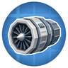 [AeroEngine](vehicles.engines.md) | Adds modular aircraft engines and flight control instruments to Create. | <EmiSearch query="@aeroengineering" /> |
| 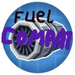 [AeroEngine fuel compat](vehicles.engines.md) | Allows AeroEngine to use kerosene from Create: The Factory Must Grow. | <EmiSearch query="@aeroengineering" /> <EmiSearch query="@tfmg" /> |
| <ItemImage id="minecraft:minecart" /> [Aeronautics Camera Sync](vehicles.airships.md) | Synchronizes the camera with rotating Sable ships. | No separate item search |
| <ItemImage id="minecraft:minecart" /> [Aeronautics Player Tilt](vehicles.airships.md) | Aligns player orientation and falling behavior with Sable sublevels. | No separate item search |
| 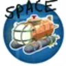 [Cosmonautics: Deep Air](space.life-support.md) | Connects sealed Deep Seas compartments to space breathing and powered artificial gravity. | <EmiSearch query="@cosmonauticsdeepair" /> |
| 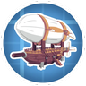 [Create Aeronautics](vehicles.assembly.md) | Turns block-built vehicles into controllable physical moving structures. | No separate item search |
| 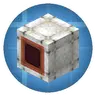 [Create Aeronautics: Encased Fluid Pipes](vehicles.airships.md) | Lets Aeronautics hot air envelopes encase Create fluid pipes. | <EmiSearch query="@aeroencasedpipe" /> |
| 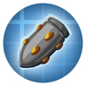 [Create Big Cannons](vehicles.weapons.md) | Adds buildable large cannons and their ammunition to Create. | <EmiSearch query="@createbigcannons" /> |
| 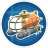 [Create Deep Seas](vehicles.water.md) | Adds marine vehicle components for Aeronautics boats and submarines. | <EmiSearch query="@create_submarine" /> |
| 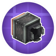 [Create Propulsion: Simulated](vehicles.engines.md) | Adds fuel and electric thrusters that propel Sable and Aeronautics vehicles. | <EmiSearch query="@createpropulsion" /> |
|  [Create Railways Navigator](transport.passenger.md) | Adds train route search, passenger information displays and schedule features. | <EmiSearch query="@createrailwaysnavigator" /> |
| 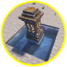 [Create Waystones Recipes](travel.destinations.md) | Reworks Waystones recipes to use Create materials and crafting. | No separate item search |
| <ItemImage id="minecraft:minecart" /> [Create: AeroWarptics](travel.destinations.md) | Adds relocation tools for physical Aeronautics vehicles. | No separate item search |
| 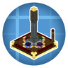 [Create: Aeroworks](vehicles.controls.md) | Adds flight controls such as gyroscopes and joysticks for Aeronautics vehicles. | <EmiSearch query="@aeroworks" /> |
| 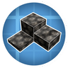 [Create: Ballast](vehicles.airships.md) | Adds layered ballast blocks for adjusting vehicle mass and balance. | <EmiSearch query="@ballastmod" /> |
|  [Create: Blocks & Bogies](transport.railway-builder.md) | Adds larger Create train bogies, including visible valve gear variants. | No separate item search |
| 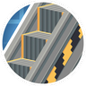 [Create: Escalated](transport.local.md) | Adds rotation-powered escalators for Create buildings. | <EmiSearch query="@escalated" /> |
| 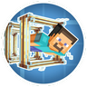 [Create: Hypertubes](transport.local.md) | Adds tube transport for moving players around Create builds. | <EmiSearch query="@create_hypertube" /> |
| 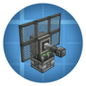 [Create: Radars](vehicles.radar.md) | Adds radar equipment to detect and track targets in Create builds. | <EmiSearch query="@create_radar" /> |
| 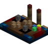 [Create: Tweaked Controllers](vehicles.controls.md) | Adds advanced handheld controls for Create contraptions. | <EmiSearch query="@create_tweaked_controllers" /> |
| 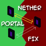 [NetherPortalFix](travel.destinations.md) | Corrects return destinations when players travel through Nether portals. | No separate item search |
|  [Steam 'n' Rails Neoforge](transport.railway-builder.md) | Expands Create railways with additional track and train components. | <EmiSearch query="@railways" /> |
| 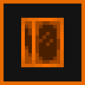 [Tempad](travel.destinations.md) | Creates travel portals to saved locations using portable and stationary devices. | <EmiSearch query="@tempad" /> |
| 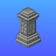 [Waystones](travel.destinations.md) | Adds activated destination stones and portable items for travel between locations. | <EmiSearch query="@waystones" /> |
| 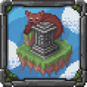 [Waystones: Sable (Create Aeronautics Addon)](travel.destinations.md) | Fixes Waystones teleportation and destination handling on Sable moving structures. | No separate item search |
