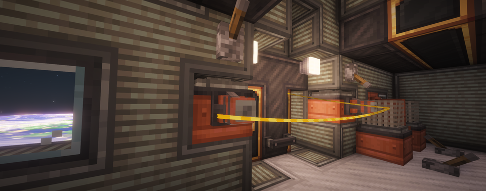

---
navigation:
  title: "Space life support"
  position: 11
  parent: reference.vehicles.md
  icon: rocketnautics:space_helmet
item_ids:
  - rocketnautics:space_helmet
  - rocketnautics:jetpack
  - rocketnautics:copper_leg_thrusters
  - rocketnautics:copper_anchor_boots
  - cosmonauticsdeepair:gravity_generator
  - create_submarine:electrolyzer
  - create_submarine:oxygene_diffuser
---

# Space life support

## Breathing equipment

<EmiSearch query="@rocketnautics" /> <EmiSearch query="@create" />

<ItemGrid>
  <ItemIcon id="create:copper_diving_helmet" />
  <ItemIcon id="create:copper_backtank" />
  <ItemIcon id="create:netherite_backtank" />
  <ItemIcon id="rocketnautics:space_helmet" />
  <ItemIcon id="rocketnautics:jetpack" />
</ItemGrid>

| Equipment | Role |
| --- | --- |
| <ItemLink id="create:copper_diving_helmet" /> | Craftable helmet for breathing with a pressurized air source. Wear it in the head slot. |
| <ItemLink id="create:copper_backtank" />, <ItemLink id="create:netherite_backtank" /> | Stored air for breathing. Charge the backtank before wearing it in the chest slot. Use its Ponder entry for charging. |
| <ItemLink id="rocketnautics:space_helmet" /> | Breathing helmet with an orbital display. It has no crafting recipe. |
| <ItemLink id="rocketnautics:jetpack" /> | Fuel-powered chestplate that supplies pressurized air and personal flight. |

Start with a Copper Diving Helmet and charged Copper Backtank. A fueled Jetpack is an alternative air source, rather than a required replacement for the backtank.

<Recipe id="create:crafting/appliances/copper_diving_helmet" />

<Recipe id="create:crafting/appliances/copper_backtank" />

***

## Jetpack fuel & flight

<ItemGrid>
  <ItemIcon id="rocketnautics:jetpack" />
  <ItemIcon id="minecraft:lava_bucket" />
  <ItemIcon id="create:spout" />
</ItemGrid>

Refill the Jetpack with Lava using <ItemLink id="minecraft:lava_bucket" /> or a <ItemLink id="create:spout" />. Toggle flight with <KeyBind id="key.rocketnautics.toggle_jetpack" />, whose default is G. Disable flight when you do not need it to conserve fuel. The Jetpack's air supply continues to consume fuel independently of that flight switch.

<Recipe id="rocketnautics:crafting/equipment/jetpack" />

***

## Oxygenated rooms

<EmiSearch query="@create_submarine" />

<ItemGrid>
  <ItemIcon id="create_submarine:electrolyzer" />
  <ItemIcon id="create_submarine:oxygene_diffuser" />
</ItemGrid>

Build an intact sealed compartment inside a Sable ship using Deep Seas compartment tools. Deep Air restores breathing inside an oxygenated compartment while the ship remains unbreached. It does not seal the hull or produce oxygen.

| Machine | Requirements |
| --- | --- |
| <ItemLink id="create_submarine:electrolyzer" /> | Water and Forge Energy to produce oxygen. |
| <ItemLink id="create_submarine:oxygene_diffuser" /> | Oxygen in its tank and a redstone signal, inside the sealed room. |

Connect the oxygen supply to the diffuser and keep it running. Their Ponder entries explain power, fluid supply and redstone.

<Recipe id="create_submarine:electrolyzer" />

<Recipe id="create_submarine:oxygen_diffuser" />

***

## Room gravity

<EmiSearch query="@cosmonauticsdeepair" />

<ItemGrid>
  <ItemIcon id="cosmonauticsdeepair:gravity_generator" />
</ItemGrid>

<ItemLink id="cosmonauticsdeepair:gravity_generator" /> provides local gravity inside an intact sealed compartment. Supply Forge Energy and a neighboring redstone signal. The generator must be in an assembled Sable ship.

Gravity and breathing are separate room functions. The gravity room itself does not need a diffuser, but keep at least one room on the ship oxygenated to retain Deep Seas compartment tracking. The generator does not change the ship's orbital gravity.

<Recipe id="cosmonauticsdeepair:gravity_generator" />

***

## Personal movement

<ItemGrid>
  <ItemIcon id="rocketnautics:copper_leg_thrusters" />
  <ItemIcon id="rocketnautics:copper_anchor_boots" />
</ItemGrid>

| Equipment | Role |
| --- | --- |
| <ItemLink id="rocketnautics:copper_leg_thrusters" /> | Uses pressurized air for flight and inertial damping. Toggle damping with <KeyBind id="key.rocketnautics.toggle_dampeners" />, whose default is Z. |
| <ItemLink id="rocketnautics:copper_anchor_boots" /> | Keeps you grounded near a supporting floor, except while actively flying. It does not create room gravity. |

<Recipe id="rocketnautics:crafting/equipment/copper_leg_thrusters" />

<Recipe id="rocketnautics:crafting/equipment/copper_anchor_boots" />

***

## Related topics

- [Water vehicles](vehicles.water.md)
- [Orbital flight](space.vehicle-transfer.md)
- [Dimensions](world.dimensions.md)

***

## Related mods

| Mod or content | Purpose | Item search |
| --- | --- | --- |
|  [Cosmonautics: Deep Air](space.life-support.md) | Connects sealed Deep Seas compartments to space breathing and powered artificial gravity. | <EmiSearch query="@cosmonauticsdeepair" /> |
|  [Create Cosmonautics](world.dimensions.md) | Adds orbital flight, the Moon, rocket and breathing equipment, and a planetary display. | <EmiSearch query="@rocketnautics" /> |
|  [Create Deep Seas](vehicles.water.md) | Adds marine vehicle components for Aeronautics boats and submarines. | <EmiSearch query="@create_submarine" /> |
