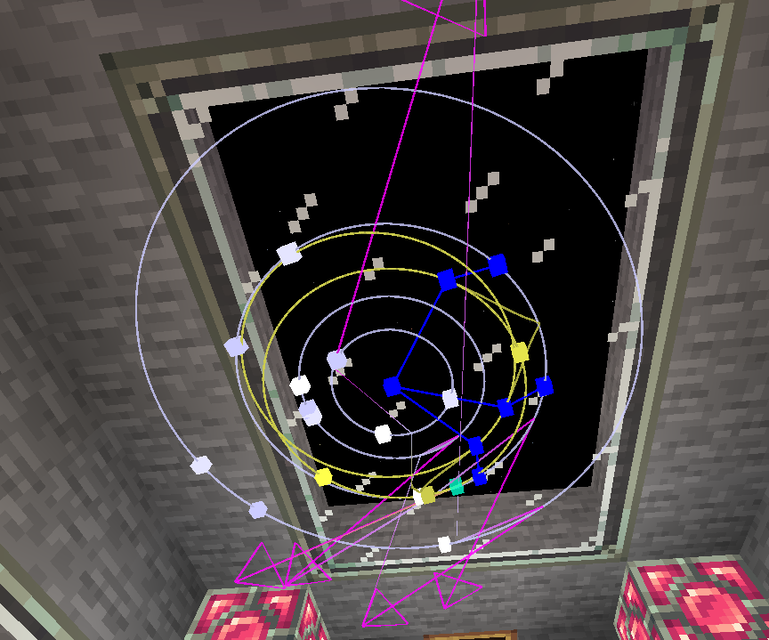
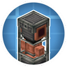

---
navigation:
  title: "Space navigation"
  position: 12
  parent: reference.vehicles.md
  icon: rocketnautics:hologram_block
item_ids:
  - rocketnautics:hologram_block
  - rocketnautics:sputnik
---

# Space navigation

 [English](https://www.youtube.com/results?search_query=Create+Cosmonautics+hologram+Earth+Moon+navigation+tutorial) · [中文](https://www.youtube.com/results?search_query=Create+Cosmonautics+%E5%85%A8%E6%81%AF%E5%9B%BE+%E5%9C%B0%E7%90%83+%E6%9C%88%E7%90%83+%E5%AF%BC%E8%88%AA+%E6%95%99%E7%A8%8B)

## Planetary display

<EmiSearch query="@rocketnautics" /> <EmiSearch query="@create" />

Hologram planetary display

<ItemLink id="rocketnautics:hologram_block" /> draws the system you are in. Short-click its configuration points to change the scale, and read the body you are aiming for before you burn fuel.

<ItemGrid><ItemIcon id="rocketnautics:hologram_block" /><ItemIcon id="rocketnautics:sputnik" /><ItemIcon id="rocketnautics:space_helmet" /></ItemGrid>

The display is a model, not a destination selector. Selecting a body on it does not steer the ship and does not open a transfer.

What the pack actually uses is the transfer height. The Overworld and the Moon both send a body to Deep Space at height 20,000, and the same height is where a descent from Deep Space comes back in. Aim for a body, cross the height, and you have moved.

## Bodies and gravity

<Recipe id="rocketnautics:hologram_block" />

The selected system connects the Overworld and Moon to surface dimensions. The hologram also depicts other bodies. do not plan a landing solely because a model is visible.

| Connected surface | Configured surface acceleration | Flight implication |
| --- | --- | --- |
| Overworld | 11.0 | Stronger gravity than the Moon |
| Moon | 2.0 | Less thrust is needed to hover. tune corrections accordingly |

For the same starting speed, lower gravity does not make a falling craft accelerate faster. Propulsion, vehicle mass and current velocity still matter, so test hover and braking rather than copying an Earth throttle setting.

On the Overworld, breathing becomes unsafe above height 5,000, before the drag curve reaches zero at 7,000 or the ascent transfer at 20,000. Equip the helmet and charged air supply before launch. The selected atmosphere map uses upper bounds: 21,000 is the upper bound of the low-density drowning band, not its starting height. Deep space and the Moon also need a breathing plan. See [Life support](space.life-support.md) and [Spaceflight](space.vehicle-transfer.md).

## Probe and helmet

<ItemLink id="rocketnautics:sputnik" /> keeps chunks loaded and reports biome colours for mapping. It is a survey tool, not a pilot, and it does not fly a route for you.

In Deep Space the Space Helmet shows an orbital display. <KeyBind id="key.rocketnautics.toggle_alignment" /> toggles the alignment helper. That changes what you see, not where the ship points.

<Recipe id="rocketnautics:sputnik" />

***

## Related mods

| Mod or content | Purpose | Item search |
| --- | --- | --- |
|  [Create Cosmonautics](world.dimensions.md) | Adds orbital flight, the Moon, rocket and breathing equipment, and a planetary display. | <EmiSearch query="@rocketnautics" /> |
