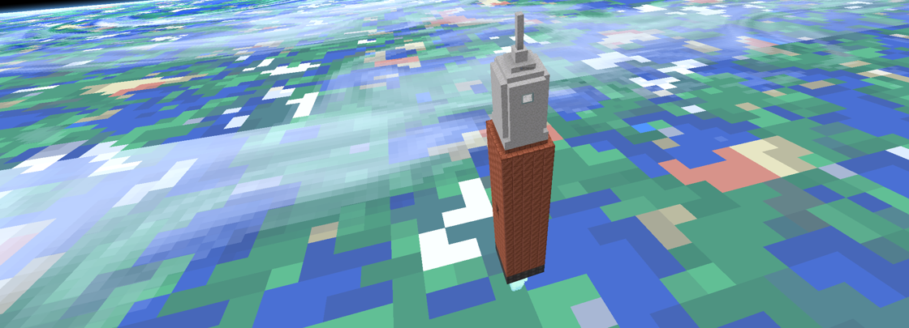
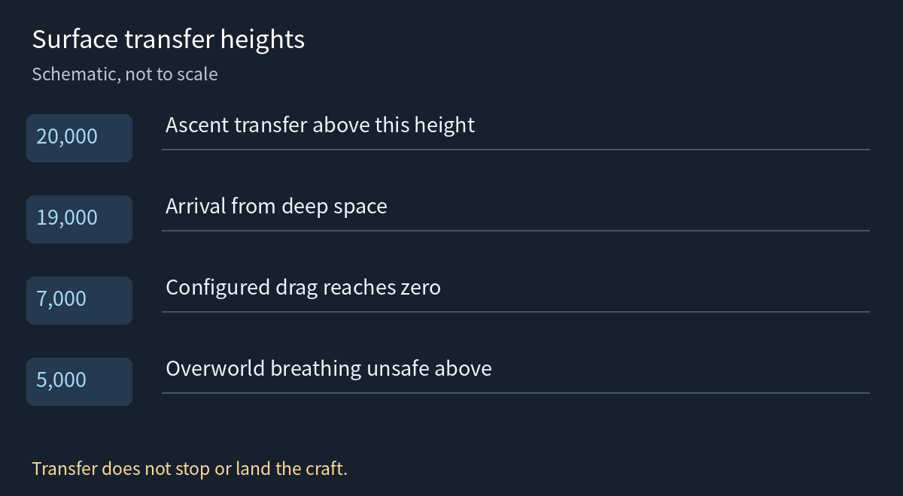

---
navigation:
  title: "Orbital flight"
  position: 10
  parent: reference.vehicles.md
  icon: rocketnautics:rocket_thruster
item_ids:
  - rocketnautics:rocket_thruster
---

# Orbital flight

 [English](https://www.youtube.com/results?search_query=Create+Cosmonautics+Rocketnautics+rocket+Moon+transfer+tutorial) · [中文](https://www.youtube.com/results?search_query=Create+Cosmonautics+%E7%81%AB%E7%AE%AD+%E6%9C%88%E7%90%83+%E7%BB%B4%E5%BA%A6%E8%BD%AC%E7%A7%BB+%E6%95%99%E7%A8%8B)

## Launch vehicle

<EmiSearch query="@rocketnautics" /> <EmiSearch query="@create" />

<ItemGrid><ItemIcon id="rocketnautics:rocket_thruster" /><ItemIcon id="rocketnautics:booster_thruster" /><ItemIcon id="rocketnautics:thruster_mount" /><ItemIcon id="rocketnautics:rcs_thruster" /><ItemIcon id="rocketnautics:titanium_ingot" /></ItemGrid>

An orbital craft is an assembled Sable vehicle carrying rocket propulsion, fuel storage and controls. Build and test the hull through [Assembly](vehicles.assembly.md), then prove its fuel supply and steering at low altitude before attempting a transfer.

| Part | Role |
| --- | --- |
| <ItemLink id="rocketnautics:rocket_thruster" /> | Main rocket propulsion |
| <ItemLink id="rocketnautics:booster_thruster" /> | Additional launch thrust |
| <ItemLink id="rocketnautics:thruster_mount" /> | Thruster mounting component |
| <ItemLink id="rocketnautics:rcs_thruster" /> | Maneuvering thrust |

Rocket fuel is not rotational power. Use the selected thruster's recipe and fuel requirements and check that the fluid connection actually supplies it. Tank height alone does not prove that a fuel connection works. For the fuel and lava-refining chain, use the recipe browser rather than assuming any fluid will burn.

## Crossing into Deep Space

The pack puts the transfer at height 20,000. Climb above it and the ship, plus the passengers aboard, moves into Deep Space. That is a world height, not a height above the launch pad, so a base on a mountain starts the count higher.

| Height | What changes | What to do |
| --- | --- | --- |
| 7,000 | Drag has fallen to zero | Stop relying on propellers |
| 20,000 | Transfer height into Deep Space | Cross it with fuel left for the return |
| Above 5,000 | Overworld breathing becomes unsafe | Equip helmet and charged air supply before launch |

The crew needs that air supply before the crossing, as covered in [Space life support](space.life-support.md).

A change in sky colour is not a transfer. Check the world height and the dimension name, not the view.

## Arriving

<ItemGrid><ItemIcon id="rocketnautics:rcs_thruster" /><ItemIcon id="simulated:altitude_sensor" /><ItemIcon id="simulated:velocity_sensor" /><ItemIcon id="create:mechanical_crafter" /><ItemIcon id="minecraft:lava_bucket" /></ItemGrid>

The destination must have a configured surface dimension. Earth and the Moon are connected in this pack. a body appearing in the hologram is not proof that it has a landable world.

From deep space, approach the intended body's transfer boundary. The surface arrival coordinate is 19,000, below the 20,000 ascent-transfer threshold, so arriving is not the same as touching down. Check the dimension, altitude and velocity before beginning a controlled descent.

1. Reserve fuel for braking, landing and the return ascent. Crossing the boundary does not stop the craft.
2. Use <ItemLink id="simulated:altitude_sensor" /> and <ItemLink id="simulated:velocity_sensor" /> to judge height and descent speed. Keep the craft controllable rather than simply cutting thrust and free-falling.
3. Test braking in short corrections. The Moon's configured surface acceleration is 2.0 against the Overworld's 11.0. lower gravity changes the thrust needed to hover, not a rule that the craft falls faster.
4. Land on clear ground before disassembly. For the return, climb above 20,000 again, navigate back toward Earth in deep space and manage a second descent.

High-speed planetary entry is hazardous. Do not treat a successful transfer as proof that the landing speed is safe.

***

## Related mods

| Mod or content | Purpose | Item search |
| --- | --- | --- |
|  [Create Cosmonautics](world.dimensions.md) | Adds orbital flight, the Moon, rocket and breathing equipment, and a planetary display. | <EmiSearch query="@rocketnautics" /> |
|  [Sable](technical.libraries.md) | Framework for interactive moving block structures. | No separate item search |
