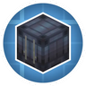

---
navigation:
  title: "Bulk storage"
  position: 2
  parent: reference.machines-storage.md
  icon: create:item_vault
---

# Bulk storage

 [English](https://www.youtube.com/results?search_query=Minecraft+1.21.1+Create%3A+Vibrant+Vaults+Bulk+storage+tutorial) · [中文](https://www.youtube.com/results?search_query=Minecraft+1.21.1+Create%3A+Vibrant+Vaults+%E5%82%A8%E5%AD%98%E5%B7%A5%E5%8E%82%E7%9A%84%E5%A4%A7%E6%89%B9%E5%8E%9F%E6%96%99+%E5%85%A5%E9%97%A8+%E6%95%99%E7%A8%8B)

## Vault capacity is blocks times twenty

<EmiSearch query="@create_connected" /> <EmiSearch query="@create" />

An <ItemLink id="create:item_vault" /> stores items as a connected block. This pack sets the vault at 20 stacks per block, so capacity follows the number of blocks in the shape rather than the face you see.

<Recipe id="create:crafting/kinetics/item_vault" />

<ItemGrid><ItemIcon id="create:item_vault" /><ItemIcon id="create_connected:item_silo" /><ItemIcon id="create_connected:inventory_access_port" /></ItemGrid>

| Shape | Blocks | Stacks held |
| --- | --- | --- |
| Single vault block | 1 | 20 |
| Two block vault | 2 | 40 |
| Three by three face | 9 | 180 |

The vault connects only through its own faces and through funnels or chutes placed against them. A vault is not a chest, so it has no screen with slots you can sort. Read it with a stock link or a display link instead.

***

## Shapes that fit a wall

<EmiSearch query="@create_vibrant_vaults" />

<ItemGrid><ItemIcon id="create_vibrant_vaults:shipping_container" /><ItemIcon id="create_vibrant_vaults:vertical_item_vault" /><ItemIcon id="create_vibrant_vaults:vertical_shipping_container" /><ItemIcon id="create_connected:fluid_vessel" /><ItemIcon id="create_vibrant_vaults:basic_shipping_container" /><ItemIcon id="create_vibrant_vaults:vertical_basic_shipping_container" /></ItemGrid>

| Block | Use |
| --- | --- |
| <ItemLink id="create_connected:item_silo" /> | A vertical item vault for a tall room |
| <ItemLink id="create_vibrant_vaults:shipping_container" /> | Wide storage that reads as a container yard |
| <ItemLink id="create_vibrant_vaults:vertical_item_vault" /> | Tall storage for a narrow room |
| <ItemLink id="create_vibrant_vaults:vertical_shipping_container" /> | The vertical container variant |
| <ItemLink id="create_connected:fluid_vessel" /> | A horizontal fluid tank |

Vibrant Vaults adds colored and dyed versions of each family. Color is a label, not a capacity change, so a red vault and a blue vault of the same shape hold the same amount.

The fluid vessel is a horizontal tank and can be turned into a boiler with reduced efficiency. Its window shape cycles with a wrench, which is worth doing before you bury it in a wall.

***

## Reaching the face you cannot see

<ItemGrid><ItemIcon id="create_connected:inventory_access_port" /><ItemIcon id="create_connected:inventory_bridge" /><ItemIcon id="create:brass_funnel" /><ItemIcon id="create:stock_link" /></ItemGrid>

| Part | Effect |
| --- | --- |
| <ItemLink id="create_connected:inventory_access_port" /> | Adds an accessible face to a container in a tight spot |
| <ItemLink id="create_connected:inventory_bridge" /> | Exposes two inventories as one connection, filters respected |
| <ItemLink id="create:brass_funnel" /> | Takes filtered items from a chosen face |
| <ItemLink id="create:stock_link" /> | Makes the vault visible to a stock network |

The bridge is the part that changes layouts. Its filters are respected when items are extracted through it, so it can present a wall of vaults as one tidy output without also leaking everything inside.

Neither part adds capacity. A vault with three access ports holds exactly what the same vault held before.

***

## Placing a first vault

<ItemGrid><ItemIcon id="create:item_vault" /><ItemIcon id="create:brass_funnel" /><ItemIcon id="create:stock_link" /></ItemGrid>

1. Craft one <ItemLink id="create:item_vault" /> and place it against the wall of the room it serves.
2. Put a funnel or chute on the face your belt reaches.
3. Add a second vault block against the first and check that the two read as one store.
4. Fit a stock link if you want a factory gauge to count the contents.

The expected result is a store that grows by adding blocks, not by adding chests. The next step is the part that feeds it without a player. [Material routing](machines.logistics.md) covers belts, arms and packages.

***

## Related mods

| Mod or content | Purpose | Item search |
| --- | --- | --- |
|  [Create: Vibrant Vaults](storage.bulk.md) | Adds more color and material variants of Create item vaults. | <EmiSearch query="@create_vibrant_vaults" /> |
