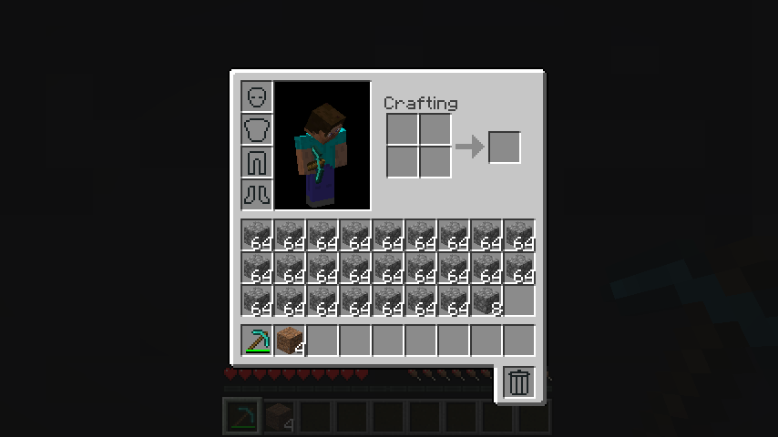
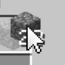
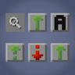

---
navigation:
  title: "Inventory tools"
  position: 1
  parent: reference.machines-storage.md
  icon: minecraft:bundle
---

# Inventory tools

 [English](https://www.youtube.com/results?search_query=Minecraft+1.21.1+Sophisticated+Inventory+Interactions+TrashSlot+Mouse+Tweaks+chest+sorting+tutorial) · [中文](https://www.youtube.com/results?search_query=Minecraft+1.21.1+Sophisticated+Inventory+Interactions+TrashSlot+Mouse+Tweaks+%E7%AE%B1%E5%AD%90+%E6%95%B4%E7%90%86+%E6%95%99%E7%A8%8B)

## Container screens

Inventory and trash slot

Sophisticated Inventory Interactions adds controls to supported screens. This pack enables it on chest, hopper, dispenser, shulker box and horse inventory menus.

| Control | What it does |
| --- | --- |
| Search field | Filters the screen down to matching slots without moving items |
| Sort container | Rearranges the open container |
| Sort player inventory | Rearranges your slots and keeps the hotbar in its own order |
| Transfer button | Sends destination matching items, or everything the destination accepts while Shift is held |

The transfer button has two modes. Left click without Shift moves what matches the destination, and left click with Shift moves everything. Search and the sort-by toggle hide themselves on screens with nine or fewer usable slots, which covers a hopper and a dispenser but not a chest.

***

### Gestures

Mouse Tweaks adds these gestures to container screens:

| Gesture | Result |
| --- | --- |
| Hold a stack and left drag over matching stacks | Collects matching items into the held stack |
| Hold Shift and left drag over slots | Quickly transfers those items to the other inventory |
| Right drag while holding a stack | Places one item each time you pass a slot, including repeated passes |
| Scroll over a stack | Moves items between that slot and the other inventory |

***

### Trash slot

If the trash slot is hidden, use <KeyBind id="key.trashslot.toggle" /> to show it.

TrashSlot adds a deletion slot to supported screens. In survival the last trashed item can be taken back, and placing a new item in the slot replaces it, which is the destructive step.

| Setting in this pack | Value | What it means |
| --- | --- | --- |
| Instant deletion | Off | A trashed item waits in the slot instead of disappearing at once |
| Delete while hidden | Off | Delete keys do nothing when the slot is not shown |
| Deny list | Empty | The configuration protects nothing by default |
| Hints | On | The slot explains itself the first time |

Deletion keys work in creative too in this pack, and creative deletion is permanent regardless of the instant deletion setting. The empty deny list does not protect valuable items from deletion.

## Picking items up

<EmiSearch query="@interactic" />

<ItemGrid><ItemIcon id="interactic:item_filter" /></ItemGrid>

Interactic Renewed provides an <ItemLink id="interactic:item_filter" /> for selective pickup. Its recipe is four copper ingots around an ender pearl.

1. Hold the filter and right click to open its item list.
2. Set the items to filter. Choose Block to reject the listed items, or Allow to collect only those items. These are buttons inside the filter window.
3. Close the window. Sneak and right click the held filter to switch filtering on or off. This does not change Block and Allow modes.

With filtering enabled in Block mode, a listed item should remain on the ground when you walk over it, while unlisted items are collected normally. If filtering is disabled, the list does not prevent ordinary pickup.

***
- [Item and fluid routing](machines.logistics.md) Belts, funnels, filters and routing.
- [Bulk storage](storage.bulk.md) Vaults and large capacity storage.

***

## Related mods

| Mod or content | Purpose | Item search |
| --- | --- | --- |
|  [Interactic Renewed](storage.handling.md) | Improves interaction with dropped items in the world. | <EmiSearch query="@interactic" /> |
|  [Mouse Tweaks](storage.handling.md) | Adds mouse-drag and scrolling shortcuts for moving inventory stacks. | No separate item search |
|  [Sophisticated Inventory Interactions](storage.handling.md) | Adds sorting, searching and transfer controls to supported inventory screens. | No separate item search |
|  [TrashSlot](storage.handling.md) | Adds an inventory trash slot for discarding unwanted items. | No separate item search |
