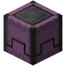
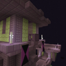

---
navigation:
  title: "Portable storage"
  position: 0
  parent: reference.machines-storage.md
  icon: minecraft:shulker_box
---

# Portable storage

## Backpacks carry the working load

<EmiSearch query="@sophisticatedbackpacks" />

A <ItemLink id="sophisticatedbackpacks:backpack" /> is a chest you wear. Each tier adds storage slots and upgrade slots, and the backpack keeps its contents when you take it off.

<ItemGrid><ItemIcon id="sophisticatedbackpacks:backpack" /><ItemIcon id="sophisticatedbackpacks:copper_backpack" /><ItemIcon id="sophisticatedbackpacks:iron_backpack" /><ItemIcon id="sophisticatedbackpacks:gold_backpack" /><ItemIcon id="sophisticatedbackpacks:diamond_backpack" /><ItemIcon id="sophisticatedbackpacks:netherite_backpack" /></ItemGrid>

| Tier | Storage slots | Upgrade slots |
| --- | --- | --- |
| <ItemLink id="sophisticatedbackpacks:backpack" /> | 9 | 1 |
| <ItemLink id="sophisticatedbackpacks:copper_backpack" /> | 18 | 1 |
| <ItemLink id="sophisticatedbackpacks:iron_backpack" /> | 27 | 2 |
| <ItemLink id="sophisticatedbackpacks:gold_backpack" /> | 36 | 2 |
| <ItemLink id="sophisticatedbackpacks:diamond_backpack" /> | 45 | 3 |
| <ItemLink id="sophisticatedbackpacks:netherite_backpack" /> | 54 | 3 |

The leather backpack is the first craft. Each step after it upgrades the backpack you already carry, so its contents survive the upgrade. The diamond step needs a shulker shell, and the netherite step is a smithing upgrade.

One rule in this pack surprises people. Shulker boxes, including the reinforced ones, are refused inside a backpack. The server configuration blocks every vanilla and reinforced shulker box as backpack contents, so a backpack cannot be used to nest shulker storage.

***

## Upgrades worth their slot

<EmiSearch query="@chipped" /> <EmiSearch query="@create" />

<ItemGrid><ItemIcon id="sophisticatedbackpacks:upgrade_base" /><ItemIcon id="sophisticatedbackpacks:crafting_upgrade" /><ItemIcon id="sophisticatedbackpacks:stonecutter_upgrade" /><ItemIcon id="sophisticatedbackpacks:tool_swapper_upgrade" /><ItemIcon id="sophisticatedbackpacks:refill_upgrade" /><ItemIcon id="sophisticatedbackpacks:feeding_upgrade" /><ItemIcon id="sophisticatedbackpacks:chipped/alchemy_bench_upgrade" /><ItemIcon id="sophisticatedbackpacks:chipped/botanist_workbench_upgrade" /><ItemIcon id="sophisticatedbackpacks:chipped/carpenters_table_upgrade" /><ItemIcon id="sophisticatedbackpacks:chipped/glassblower_upgrade" /><ItemIcon id="sophisticatedbackpacks:chipped/loom_table_upgrade" /><ItemIcon id="sophisticatedbackpacks:chipped/mason_table_upgrade" /><ItemIcon id="sophisticatedbackpacks:chipped/tinkering_table_upgrade" /><ItemIcon id="sophisticatedbackpacks:jukebox_upgrade" /></ItemGrid>

| Upgrade | Saves you |
| --- | --- |
| <ItemLink id="sophisticatedbackpacks:crafting_upgrade" /> | A crafting table in the field |
| <ItemLink id="sophisticatedbackpacks:stonecutter_upgrade" /> | A stonecutter, for shaped blocks |
| <ItemLink id="sophisticatedbackpacks:tool_swapper_upgrade" /> | Opening the inventory to change tool |
| <ItemLink id="sophisticatedbackpacks:refill_upgrade" /> | Restocking a hotbar stack from the pack |
| <ItemLink id="sophisticatedbackpacks:feeding_upgrade" /> | Eating from the pack during a fight |

<Recipe id="sophisticatedbackpacks:upgrade_base" />

<Recipe id="sophisticatedbackpacks:crafting_upgrade" />

The upgrade base needs brass, so the first upgrade arrives after a Create workshop, not before it. This pack also carries seven Chipped workstation upgrades, which turn the backpack into a portable botanist bench, glassblower, carpenter table, mason table, loom, alchemy bench or tinkering table.

Stack multipliers, nested portable containers, automatic processing, fluid storage, energy storage and creature capture are not available here. Plan around the basic versions rather than expecting an upgraded variant.

***

## Shulker boxes for the big haul

<EmiSearch query="@reinfshulker" />

<ItemGrid><ItemIcon id="minecraft:shulker_box" /><ItemIcon id="reinfshulker:copper_shulker_box" /><ItemIcon id="reinfshulker:iron_shulker_box" /><ItemIcon id="reinfshulker:gold_shulker_box" /><ItemIcon id="reinfshulker:diamond_shulker_box" /><ItemIcon id="reinfshulker:netherite_shulker_box" /></ItemGrid>

| Box | Slots | Note |
| --- | --- | --- |
| Vanilla shulker box | 27 | Keeps contents when broken |
| <ItemLink id="reinfshulker:copper_shulker_box" /> | 45 | First reinforced tier |
| <ItemLink id="reinfshulker:iron_shulker_box" /> | 54 | Same as a double chest |
| <ItemLink id="reinfshulker:gold_shulker_box" /> | 81 | Three chests |
| <ItemLink id="reinfshulker:diamond_shulker_box" /> | 108 | Four chests |
| <ItemLink id="reinfshulker:netherite_shulker_box" /> | 108 | Resists blast, fire and lava |

Reinforced boxes are crafted from reinforced chests or in the shaped recipe, and the netherite tier is a smithing upgrade. Any tier can be dyed, which is the cheapest way to label a wall of storage.

Easy Shulker Boxes lets you open a supported shulker box from the inventory instead of placing it. Shulker Drops Two raises the shell drop to two by default in this pack, so a shulker farm pays back faster.

Next step is storage that a factory can fill. [Bulk storage](storage.bulk.md) covers vaults and silos.

***

## Related mods

| Mod or content | Purpose | Item search |
| --- | --- | --- |
|  [Easy Shulker Boxes](storage.portable.md) | Lets players browse and move shulker box contents directly from the inventory. | No separate item search |
|  [Reinforced Shulker Boxes](storage.portable.md) | Adds upgraded shulker boxes with larger storage capacity. | <EmiSearch query="@reinfshulker" /> |
|  [Shulker Drops Two](storage.portable.md) | Changes shulker shell drop counts and chances, including two-shell drops. | No separate item search |
| <ItemImage id="minecraft:chest" /> [Sophisticated Backpacks](storage.portable.md) | Adds dyeable backpacks with storage tiers and selected utility upgrades. | <EmiSearch query="@sophisticatedbackpacks" /> |
| <ItemImage id="minecraft:chest" /> [Sophisticated Backpacks Create Integration](storage.portable.md) | Connects backpacks to native Create contraptions. Sable vehicle support is unverified. | No separate item search |
