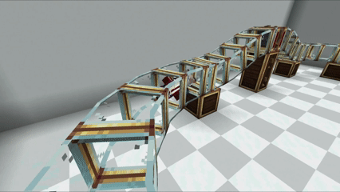

---
navigation:
  title: "Local transport"
  position: 0
  parent: reference.vehicles.md
  icon: minecraft:powered_rail
---

# Local transport

 [English](https://www.youtube.com/results?search_query=Create+Simulated+Offroad+road+vehicles+handles+suspension+tutorial) · [中文](https://www.youtube.com/results?search_query=Create+Simulated+Offroad+%E8%BD%A6%E8%BE%86+%E6%82%AC%E6%8C%82+%E6%89%8B%E6%9F%84+%E6%95%99%E7%A8%8B)

## Hypertube line

<EmiSearch query="@create" /> <EmiSearch query="@create_hypertube" />

Hypertube sections and supports

<ItemGrid><ItemIcon id="create_hypertube:hypertube" /><ItemIcon id="create_hypertube:hypertube_entrance" /><ItemIcon id="create_hypertube:hypertube_accelerator" /><ItemIcon id="create_hypertube:hypertube_junction" /><ItemIcon id="create_hypertube:tube_scanner_attachment" /><ItemIcon id="create_hypertube:redstone_detector_tube_attachment" /></ItemGrid>

A hypertube is a tube you are fired through, not a vehicle you drive.

1. Right-click a placed tube while holding another tube, then place the second one. The pair is now connected.
2. Continue the line the same way. Use a wrench on a segment to change its segment count.
3. Put an entrance at each end and give it at least 16 revolutions per minute. Faster rotation moves you faster.
4. Add accelerators along the run to raise speed, or set one to brake mode by right-clicking it.

An entrance with no rotation is a hole in the wall. The entrance mode itself is changed with a wrench, and a Redstone Detector Attachment can switch the mode from a signal.

| Part | Does | Set with |
| --- | --- | --- |
| <ItemLink id="create_hypertube:hypertube_accelerator" /> | Raises speed, or brakes | Right-click to toggle brake mode |
| <ItemLink id="create_hypertube:hypertube_junction" /> | Joins up to three tubes | Wrench to cycle modes |
| <ItemLink id="create_hypertube:tube_scanner_attachment" /> | Detects a traveller | Nothing, it outputs redstone |
| <ItemLink id="create_hypertube:redstone_detector_tube_attachment" /> | Switches entrance or accelerator mode | Its redstone input |

A junction can join three tubes. While you travel you pick the branch with your movement keys. In Continue mode travellers always take the side tubes, and in Center mode they always take the front tube. The detector attachment toggles between those two forced modes.

The scanner attachment reads 8 redstone power for a baby and 15 for an adult, so a signal line can count who passed. Attachments also fit into accelerators on any side at the same time.

## Walkways

<EmiSearch query="@escalated" />

<ItemGrid><ItemIcon id="escalated:metal_walkway_steps" /><ItemIcon id="escalated:wooden_walkway_steps" /></ItemGrid>

Escalated adds moving walkway steps in metal and wood. They are rotation powered like any Create machine, and they carry you along a floor rather than through a tube. Use them at the station end of a hypertube, where you want a short ride to the platform instead of another entrance.

<Recipe id="escalated:metal_walkway_steps" />

***

## Related mods

| Mod or content | Purpose | Item search |
| --- | --- | --- |
|  [Create: Escalated](transport.local.md) | Adds rotation-powered escalators for Create buildings. | <EmiSearch query="@escalated" /> |
|  [Create: Hypertubes](transport.local.md) | Adds tube transport for moving players around Create builds. | <EmiSearch query="@create_hypertube" /> |
