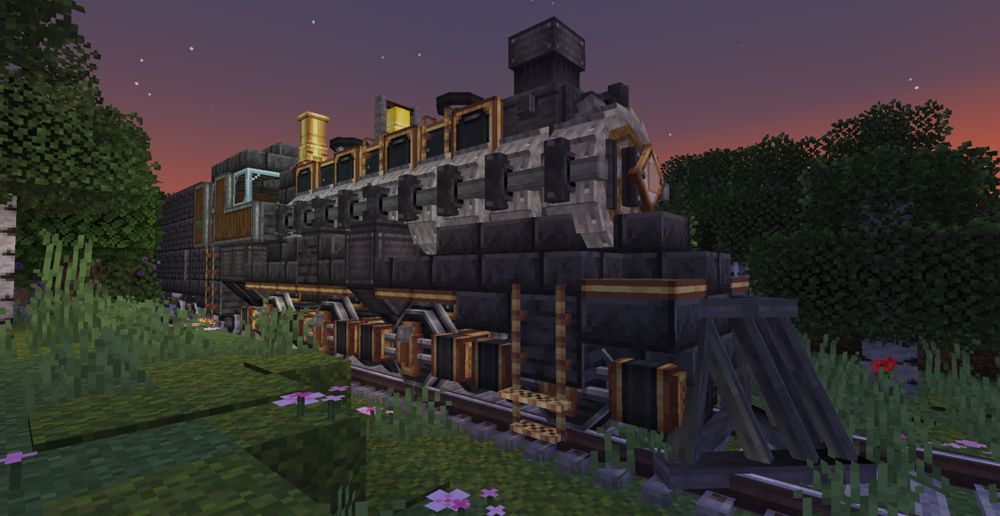
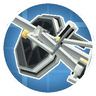
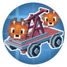

---
navigation:
  title: "Railways"
  position: 2
  parent: reference.vehicles.md
  icon: create:track
---

# Railways

## Line, station, schedule

<EmiSearch query="@create" />

Train bodywork with Bells & Whistles fittings

<ItemGrid><ItemIcon id="create:track" /><ItemIcon id="create:track_station" /><ItemIcon id="create:controls" /><ItemIcon id="create:schedule" /><ItemIcon id="create:railway_casing" /></ItemGrid>

A Create train needs three things in this order. A continuous line of <ItemLink id="create:track" />, a <ItemLink id="create:track_station" /> on that line, and a <ItemLink id="create:controls" /> block inside the body you intend to drive.

Lay the track first and check that both ends meet. A one block gap is enough to stop a train, and track laid on a curve needs a radius the bogies can follow.

Then build the carriage as a normal block structure and place the Train Controls inside it. Place the station beside the track, give it a name, and assemble the train through the station. The station is what turns the blocks into a train, so a carriage with no station nearby stays a building.

The <ItemLink id="create:schedule" /> is the timetable. Put it in the train, add the stations in the order you want, and set the conditions. A train with no schedule runs once and stops.

<Recipe id="create:crafting/kinetics/track_station" />

<Recipe id="create:crafting/kinetics/controls" />

## Track families

<ItemGrid><ItemIcon id="create:track" /><ItemIcon id="create:track_station" /><ItemIcon id="create:controls" /><ItemIcon id="create:schedule" /></ItemGrid>

Create supplies the standard track and the station and controls that go with it. Steam 'n' Rails extends the families with narrower and wider gauges, switches, signals and conductor equipment. Gauge is not cosmetic. A train assembles on the track it was built against, and a switch only joins tracks of the same gauge.

Build a short test line in the gauge you intend to use before you build the main line. Changing gauge halfway through is a rebuild, not an adjustment.

## Bogies

<ItemGrid><ItemIcon id="create:railway_casing" /></ItemGrid>

Blocks & Bogies adds a Bogie Customisation interface rather than a separate set of bogie items. Right-click a placed bogie to open it and choose the driver or truck role, then the axle count, size and length the menu offers. Valve gear styles are further choices in the same menu, and the menu can switch to the Steam 'n' Rails styles.

| Choice | Changes | Keep consistent |
| --- | --- | --- |
| Role | Whether the bogie drives or carries | One driver bogie per train |
| Axle count | How many wheels touch the rail | Match the carriage weight |
| Size and length | The wheel and frame footprint | Match the curve radius |
| Valve gear | Visible motion | Appearance only |

Not every combination is interchangeable. A long bogie on a tight curve derails where a short one holds, so test the combination on the tightest curve on your line.

## Freight and passengers

<ItemGrid><ItemIcon id="create:schedule" /><ItemIcon id="create:track_station" /></ItemGrid>

A carriage carries what you put in it. Seats, storage and fluid tanks are ordinary blocks inside the train body, and the schedule decides where it stops. For passenger information and route search, see [Train travel](transport.passenger.md).

***

## Related mods

| Mod or content | Purpose | Item search |
| --- | --- | --- |
|  [Create: Blocks & Bogies](transport.railway-builder.md) | Adds larger Create train bogies, including visible valve gear variants. | No separate item search |
|  [Steam 'n' Rails Neoforge](transport.railway-builder.md) | Expands Create railways with additional track and train components. | <EmiSearch query="@railways" /> |
