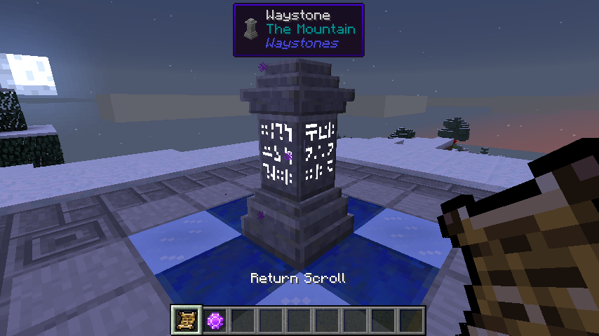
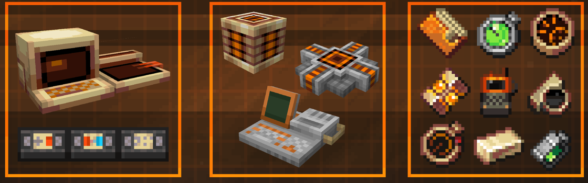

---
navigation:
  title: "Teleportation"
  position: 13
  parent: reference.vehicles.md
  icon: minecraft:ender_pearl
---

# Teleportation

 [English](https://www.youtube.com/results?search_query=Minecraft+1.21.1+Create%3A+AeroWarptics+Create+Waystones+Recipes+Teleportation+tutorial) · [中文](https://www.youtube.com/results?search_query=Minecraft+1.21.1+Create%3A+AeroWarptics+Create+Waystones+Recipes+%E4%BD%BF%E7%94%A8%E5%9B%BA%E5%AE%9A%E4%B8%8E%E4%BE%BF%E6%90%BA%E4%BC%A0%E9%80%81%E7%82%B9+%E5%85%A5%E9%97%A8+%E6%95%99%E7%A8%8B)

## Waystone network

<EmiSearch query="@waystones" />

A Waystone above the landscape

<ItemGrid><ItemIcon id="waystones:waystone" /><ItemIcon id="waystones:mossy_waystone" /><ItemIcon id="waystones:deepslate_waystone" /><ItemIcon id="waystones:blackstone_waystone" /><ItemIcon id="waystones:sandy_waystone" /><ItemIcon id="waystones:red_nether_bricks_waystone" /><ItemIcon id="waystones:end_stone_waystone" /><ItemIcon id="waystones:mud_bricks_waystone" /><ItemIcon id="waystones:prismarine_waystone" /><ItemIcon id="waystones:purpur_waystone" /></ItemGrid>

A <ItemLink id="waystones:waystone" /> becomes a destination only after you use it once. That first use activates it and adds it to your list. An unactivated stone does not appear in the travel screen, which is the usual reason a base you can see is not on the list.

The material is appearance. A mossy, deepslate, blackstone, sandy, nether brick or end stone waystone behaves like the plain one. The screen shows the experience cost and any cooldown before you confirm, so read the row rather than clicking through.

## Portable and shared travel

<ItemGrid><ItemIcon id="waystones:warp_stone" /><ItemIcon id="waystones:blank_scroll" /><ItemIcon id="waystones:orange_sharestone" /><ItemIcon id="waystones:white_portstone" /><ItemIcon id="waystones:warp_plate" /><ItemIcon id="waystones:dormant_shard" /><ItemIcon id="waystones:attuned_shard" /></ItemGrid>

| Item | Scope | How it works |
| --- | --- | --- |
| <ItemLink id="waystones:warp_stone" /> | Personal, to any activated stone | Use it to open the list |
| <ItemLink id="waystones:blank_scroll" /> | Personal, one destination | Use it on a waystone to bind it |
| <ItemLink id="waystones:orange_sharestone" /> | Group, stones of the same colour | Connect matching colours |
| <ItemLink id="waystones:white_portstone" /> | Departure only | Trades access for a destination slot |
| <ItemLink id="waystones:warp_plate" /> | Paired plates | Attune a shard in one, carry it to the other |

A <ItemLink id="waystones:warp_plate" /> pair is the only one of these that moves you between two fixed points without a waystone at either end. Attune a <ItemLink id="waystones:dormant_shard" /> in the first plate, then use the <ItemLink id="waystones:attuned_shard" /> on the second. Recolour a sharestone with the recipe below to put it in a different group.

<Recipe id="waystones:orange_sharestone_recolor" />

## Tempad

<EmiSearch query="@tempad" />

Tempad destination equipment

<ItemGrid><ItemIcon id="tempad:tempad" /><ItemIcon id="tempad:location_card" /><ItemIcon id="tempad:timedoor_projector" /><ItemIcon id="tempad:workstation" /><ItemIcon id="tempad:chronon_generator" /><ItemIcon id="tempad:chronon_cell" /><ItemIcon id="tempad:card_wallet" /><ItemIcon id="tempad:chronometer" /><ItemIcon id="tempad:chronon_battery" /><ItemIcon id="tempad:location_broadcaster" /><ItemIcon id="tempad:timedoor_marker" /></ItemGrid>

A <ItemLink id="tempad:tempad" /> stores <ItemLink id="tempad:location_card" /> entries and opens a <ItemLink id="tempad:timedoor_projector" /> door to one of them. It is a coordinate system, not a network. A saved place is a fixed point, so it does not follow a moving ship, and it does not know whether the destination is still safe.

Power comes from chronon equipment. A <ItemLink id="tempad:chronon_generator" /> with a <ItemLink id="tempad:chronon_cell" /> is the stationary supply, and the <ItemLink id="tempad:workstation" /> is where cards and devices are made. Check the card in the Tempad screen before you step through.

## Moving destinations

<EmiSearch query="@create" />

<ItemGrid><ItemIcon id="waystones:waystone" /><ItemIcon id="simulated:physics_assembler" /></ItemGrid>

Waystones: Sable lets a waystone travel on an assembled body. Place and activate the waystone on the ship, and it appears as a destination in the Sable group. It teleports the player to the moving stone, not the ship to another dimension.

Create: AeroWarptics relocates an assembled ship within one dimension. Neither addon is a cross dimension ship transfer. For that, see [Orbital flight](space.vehicle-transfer.md).

## Choosing a system

<ItemGrid><ItemIcon id="minecraft:obsidian" /></ItemGrid>

| Need | Use |
| --- | --- |
| A base network you return to | Waystones |
| A group of friends sharing a base | Sharestones |
| Two fixed points with no stone | Warp plates |
| A pocket list of coordinates | Tempad |
| A destination that moves with a ship | Waystones: Sable |

***

***

## Related mods

| Mod or content | Purpose | Item search |
| --- | --- | --- |
|  [Create Waystones Recipes](travel.destinations.md) | Reworks Waystones recipes to use Create materials and crafting. | No separate item search |
| <ItemImage id="minecraft:minecart" /> [Create: AeroWarptics](travel.destinations.md) | Adds relocation tools for physical Aeronautics vehicles. | No separate item search |
|  [NetherPortalFix](travel.destinations.md) | Corrects return destinations when players travel through Nether portals. | No separate item search |
|  [Tempad](travel.destinations.md) | Creates travel portals to saved locations using portable and stationary devices. | <EmiSearch query="@tempad" /> |
|  [Waystones](travel.destinations.md) | Adds activated destination stones and portable items for travel between locations. | <EmiSearch query="@waystones" /> |
|  [Waystones: Sable (Create Aeronautics Addon)](travel.destinations.md) | Fixes Waystones teleportation and destination handling on Sable moving structures. | No separate item search |
