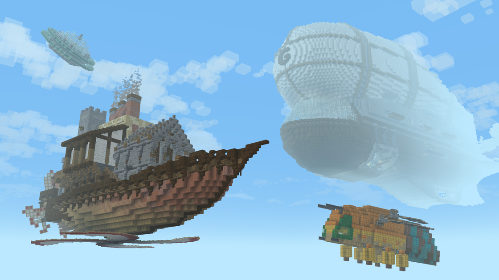

---
navigation:
  title: "Airships"
  position: 7
  parent: reference.vehicles.md
  icon: minecraft:elytra
---

# Airships

## Lift & envelopes

<EmiSearch query="@aeroencasedpipe" /> <EmiSearch query="@ballastmod" />

Airships with different hulls and lift arrangements

<ItemGrid>
  <ItemIcon id="aeronautics:white_envelope" />
  <ItemIcon id="aeronautics:adjustable_burner" />
  <ItemIcon id="aeronautics:white_envelope_encased_shaft" />
  <ItemIcon id="aeroencasedpipe:white_envelope_encased_pipe" />
  <ItemIcon id="ballastmod:ballast_stones" />
</ItemGrid>

| Shown items |
| --- |
| <ItemLink id="aeronautics:white_envelope" /> |
| <ItemLink id="aeronautics:adjustable_burner" /> |
| <ItemLink id="aeronautics:white_envelope_encased_shaft" /> |
| <ItemLink id="aeroencasedpipe:white_envelope_encased_pipe" /> |
| <ItemLink id="ballastmod:ballast_stones" /> |

Hot Air Envelopes and Hot Air Burners form the buoyancy family. Envelopes, envelope encased shafts and addon envelope encased fluid pipes come in sixteen dye colors. Ballast Stones gain mass with each added layer, up to eight layers.

### First envelope

<Recipe id="aeronautics:white_envelope" />

Two white wool and two sticks make four <ItemLink id="aeronautics:white_envelope" />.

### Hot air burner

<Recipe id="aeronautics:adjustable_burner" />

Craft <ItemLink id="aeronautics:adjustable_burner" /> for the hot-air envelope system. Use the envelope and burner Ponder entries for the working arrangement.

***

## Propellers & sails

<ItemGrid>
  <ItemIcon id="aeronautics:propeller_bearing" />
  <ItemIcon id="aeronautics:gyroscopic_propeller_bearing" />
  <ItemIcon id="aeronautics:wooden_propeller" />
  <ItemIcon id="aeronautics:andesite_propeller" />
  <ItemIcon id="aeronautics:smart_propeller" />
  <ItemIcon id="simulated:white_symmetric_sail" />
</ItemGrid>

| Shown items |
| --- |
| <ItemLink id="aeronautics:propeller_bearing" /> |
| <ItemLink id="aeronautics:gyroscopic_propeller_bearing" /> |
| <ItemLink id="aeronautics:wooden_propeller" /> |
| <ItemLink id="aeronautics:andesite_propeller" /> |
| <ItemLink id="aeronautics:smart_propeller" /> |
| <ItemLink id="simulated:white_symmetric_sail" /> |

Wooden, Andesite and Smart Propellers have dedicated bearings. Symmetric sails provide another aerodynamic family. Getting started: assemble a supported hull, then use the envelope, burner and propeller Ponder entries to plan lift and thrust. Decorative volume alone does not provide lift.

***

## Ship orientation

Aeronautics Camera Sync tilts the viewpoint with a sloping ship deck. Aeronautics Player Tilt aligns the player body with the ship. Camera tilt and body tilt are separate controls. Neither steers the ship.

| Action | Your key | Default |
| --- | --- | --- |
| Toggle camera tilt | <KeyBind id="key.aero_cam_sync.toggle" /> | I |
| Toggle player tilt | <KeyBind id="key.aero_player_tilt.toggle" /> | O |
| Camera settings | <KeyBind id="key.aero_cam_sync.open_config" /> | Unbound |
| Player tilt settings | <KeyBind id="key.aero_player_tilt.open_config" /> | Unbound |

Assign settings shortcuts in Options, Controls, then Key Binds. Check conflicts before using the default keys. If deck tilt makes aiming uncomfortable, adjust camera and body tilt separately in their settings.

## Related topics

- [Browse recipe](help.search.md)

***

## Related mods

| Mod or content | Purpose | Item search |
| --- | --- | --- |
| <ItemImage id="minecraft:minecart" /> [Aeronautics Camera Sync](vehicles.airships.md) | Synchronizes the camera with rotating Sable ships. | No separate item search |
| <ItemImage id="minecraft:minecart" /> [Aeronautics Player Tilt](vehicles.airships.md) | Aligns player orientation and falling behavior with Sable sublevels. | No separate item search |
|  [Create Aeronautics: Encased Fluid Pipes](vehicles.airships.md) | Lets Aeronautics hot air envelopes encase Create fluid pipes. | <EmiSearch query="@aeroencasedpipe" /> |
|  [Create: Ballast](vehicles.airships.md) | Adds layered ballast blocks for adjusting vehicle mass and balance. | <EmiSearch query="@ballastmod" /> |
