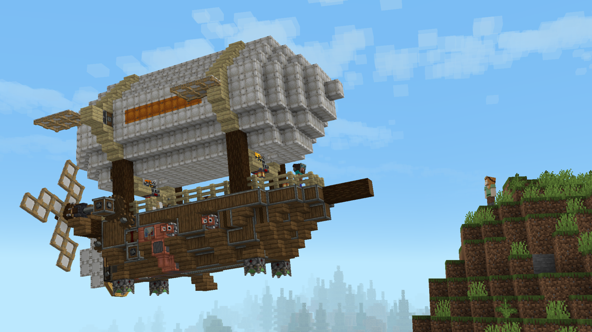

---
navigation:
  title: "Vehicle assembly"
  position: 4
  parent: reference.vehicles.md
  icon: create:mechanical_bearing
---

# Vehicle assembly

 [English](https://www.youtube.com/results?search_query=Minecraft+1.21.1+Create+Aeronautics+Vehicle+assembly+tutorial) · [中文](https://www.youtube.com/results?search_query=Minecraft+1.21.1+Create+Aeronautics+%E7%BB%84%E8%A3%85%E5%92%8C%E6%93%8D%E4%BD%9C%E7%A7%BB%E5%8A%A8%E8%BD%BD%E5%85%B7+%E5%85%A5%E9%97%A8+%E6%95%99%E7%A8%8B)

## Assembly order

<EmiSearch query="@create" />

Cloud Skipper airship build

<ItemGrid><ItemIcon id="simulated:physics_assembler" /><ItemIcon id="simulated:honey_glue" /><ItemIcon id="create:super_glue" /><ItemIcon id="simulated:contraption_diagram" /><ItemIcon id="simulated:navigation_table" /></ItemGrid>

A Simulated Contraption is a group of blocks that this pack turns into one physical body. Build the shape first, then glue it, then assemble it.

1. Build the hull, deck and mount points in place, with the wheels, bearings and propulsion already fitted.
2. Mark the body with <ItemLink id="create:super_glue" /> or <ItemLink id="simulated:honey_glue" />. Glue selects faces, so glue the hull to the deck and the deck to the machinery.
3. Place the <ItemLink id="simulated:physics_assembler" /> against the build, hold use on it, and pull the lever.

Blocks along diagonal edges are included, so a stair-stepped hull does not need a glued strip on every step. The assembler used for the first assembly is not needed afterwards, and any assembler can take the body apart again.

| Message | What it means | Fix |
| --- | --- | --- |
| Cannot disassemble onto the same Simulated Contraption! | The assembler is part of the body it is trying to release | Move the assembler off the body |
| Too fast to disassemble! | The body is still moving | Stop it, then retry |
| Too far from the ground to disassemble! | The body is too high to set the blocks back down | Lower it or assemble over solid ground |
| Could not align Simulated Contraption to disassemble! | The stored layout no longer fits the space | Clear the landing area |

<Recipe id="simulated:physics_assembler" />

<Recipe id="offroad:borehead_bearing" />
## Moving a body before it flies

A new body starts as one block. Assemble it once, then build the rest onto the assembled block, so every part joins the same physics object from the first piece instead of being glued together later.

<ItemGrid><ItemIcon id="simulated:iron_handle" /><ItemIcon id="simulated:physics_assembler" /><ItemIcon id="simulated:honey_glue" /></ItemGrid>

Small bodies can be punched around, but mass rises with size, so fit an <ItemLink id="simulated:iron_handle" /> and sneak use it to drag the body where you want it. Drag first, then finish the hull, because a half-built body is lighter than a finished one.

Diagonal steps stay attached, so a stair-shaped hull does not need a glued strip on every step. A part with no connection in any direction breaks off as its own separate body, which is how a glued joint failing in flight looks on the ground.

## Connections and splitting

<ItemGrid><ItemIcon id="simulated:docking_connector" /><ItemIcon id="simulated:paired_docking_connector" /><ItemIcon id="simulated:rope_winch" /><ItemIcon id="simulated:rope_connector" /><ItemIcon id="simulated:rope_coupling" /><ItemIcon id="simulated:merging_glue" /><ItemIcon id="simulated:swivel_bearing" /><ItemIcon id="simulated:spring" /></ItemGrid>

Two bodies stay separate unless you join them. A Slime Ball merges any two Simulated Contraptions, and <ItemLink id="simulated:merging_glue" /> glues across a gap between two bodies. Disconnected sections of one body split off on their own, which is what happens when a glued joint is broken in flight.

Docking connectors join a moving body to a fixed one. Rope parts tow and tether, and the swivel bearing and spring absorb the movement between two bodies instead of passing it through the frame.

| Part | Holds what to what | Use it for |
| --- | --- | --- |
| <ItemLink id="simulated:docking_connector" /> | Moving body to a fixed dock | Mooring an airship or loading a barge |
| <ItemLink id="simulated:rope_winch" /> and <ItemLink id="simulated:rope_connector" /> | Two points along a rope | Towing and securing a load |
| <ItemLink id="simulated:swivel_bearing" /> | Two bodies that must rotate | A trailed car or a swinging mount |
| <ItemLink id="simulated:spring" /> | Two bodies that must move apart and back | Suspension and shock absorption |

## Wheels

<ItemGrid><ItemIcon id="offroad:wheel_mount" /><ItemIcon id="offroad:small_tire" /><ItemIcon id="offroad:tire" /><ItemIcon id="offroad:large_tire" /><ItemIcon id="offroad:monstrous_tire" /><ItemIcon id="offroad:borehead_bearing" /></ItemGrid>

A <ItemLink id="offroad:wheel_mount" /> takes one tire on its front face. The pack refuses a tire placed anywhere else, so aim at the mount face that points away from the chassis. Mounts carry the body, they do not drive it, so a rolling chassis still needs a propeller, thruster or engine and a steering input.

<ItemLink id="offroad:borehead_bearing" /> spins a cutting head for excavation. It is a work attachment, not a wheel.

***

## Related mods

| Mod or content | Purpose | Item search |
| --- | --- | --- |
|  [Create Aeronautics](vehicles.assembly.md) | Turns block-built vehicles into controllable physical moving structures. | No separate item search |
