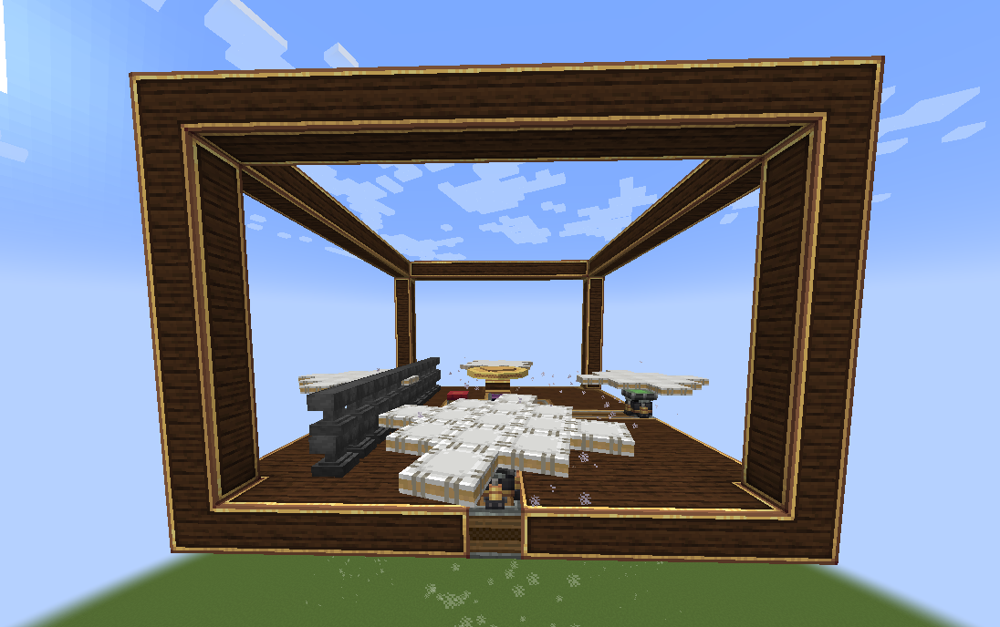

---
navigation:
  title: "Vehicle controls"
  position: 5
  parent: reference.vehicles.md
  icon: create:controls
---

# Vehicle controls

 [English](https://www.youtube.com/results?search_query=Minecraft+1.21.1+Create%3A+Aeroworks+Create%3A+Tweaked+Controllers+Vehicle+controls+tutorial) · [中文](https://www.youtube.com/results?search_query=Minecraft+1.21.1+Create%3A+Aeroworks+Create%3A+Tweaked+Controllers+%E6%8E%A7%E5%88%B6%E4%B8%8E%E7%A8%B3%E5%AE%9A%E8%BD%BD%E5%85%B7+%E5%85%A5%E9%97%A8+%E6%95%99%E7%A8%8B)

## Console and modules

<EmiSearch query="@aeroworks" /> <EmiSearch query="@create" />

A cockpit with Aeroworks control modules

<ItemGrid><ItemIcon id="aeroworks:control_desk" /><ItemIcon id="aeroworks:joystick_module" /><ItemIcon id="aeroworks:throttle_quadrant_module" /><ItemIcon id="aeroworks:wheel_module" /><ItemIcon id="aeroworks:lever_module" /><ItemIcon id="aeroworks:pedal_module" /><ItemIcon id="aeroworks:button_panel_module" /><ItemIcon id="create:redstone_link" /><ItemIcon id="create:wrench" /></ItemGrid>

A <ItemLink id="aeroworks:control_desk" /> is a socket board. Right-click a socket with a module to mount it, and use a wrench to pull it back out. Removed modules keep their settings, so you can move a tuned joystick to a second ship.

Sneak and use a placed control to open its configuration. There you set the key, the Redstone Link frequencies and the module options. A held module is configured by sneaking and using the air. Several modules can share one console, and small modules fit large sockets.

Right-click the desk with an empty hand to take control. Your keyboard and mouse then move the mounted controls, and each direction transmits on its own Redstone Link frequency with a strength that follows how far you push. Escape releases control.

Touching consoles form one deck. One player controls a deck at a time, and consoles placed apart stay separate stations. That is how a pilot seat and a throttle station on the same bridge behave as one cockpit.

## Servos

<ItemGrid><ItemIcon id="aeroworks:mechanical_servo" /><ItemIcon id="aeroworks:stepper_servo" /><ItemIcon id="aeroworks:gyroscope" /></ItemGrid>

Servos turn a redstone signal back into a shaft angle, which is how a console channel reaches a control surface.

| Part | Signal to angle | Set on the block |
| --- | --- | --- |
| <ItemLink id="aeroworks:mechanical_servo" /> | Angle proportional to signal strength across a range | Right-click to set the rotation range |
| <ItemLink id="aeroworks:stepper_servo" /> | Moves in fixed steps, one step per signal level | Right-click to set the angle of each step |

Both finish the current rotation before answering a new signal, so a fast input change lags by one movement rather than jumping. A stepper accepts a signal on either side, one side turns each way, and power on both sides holds it still. The <ItemLink id="aeroworks:gyroscope" /> keeps a body level, which is a stabiliser rather than an input.

## Sensors and receivers

<EmiSearch query="@create_tweaked_controllers" />

<ItemGrid><ItemIcon id="simulated:steering_wheel" /><ItemIcon id="simulated:throttle_lever" /><ItemIcon id="simulated:altitude_sensor" /><ItemIcon id="simulated:velocity_sensor" /><ItemIcon id="simulated:gimbal_sensor" /><ItemIcon id="simulated:directional_linked_receiver" /><ItemIcon id="simulated:optical_sensor" /><ItemIcon id="simulated:laser_sensor" /><ItemIcon id="create_tweaked_controllers:tweaked_linked_controller" /><ItemIcon id="simulated:modulating_linked_receiver" /></ItemGrid>

A manual input is a block you turn. A sensor is a block that reports.

| Part | Reports or does | Read it with |
| --- | --- | --- |
| <ItemLink id="simulated:steering_wheel" /> | Continuous steering input | Right-click and drag |
| <ItemLink id="simulated:throttle_lever" /> | Continuous throttle input | Right-click and drag |
| <ItemLink id="simulated:altitude_sensor" /> | Redstone strength from height, with a minimum and maximum set in its screen | Goggles for air pressure and exact height |
| <ItemLink id="simulated:velocity_sensor" /> | Relative speed and direction towards or away | Its screen |
| <ItemLink id="simulated:gimbal_sensor" /> | Tilt on two axes | Its screen |
| <ItemLink id="simulated:optical_sensor" /> | Detected block and distance | Its screen |
| <ItemLink id="simulated:laser_sensor" /> | Distance along a line | Its screen |

The altitude sensor increases output as it climbs by default and can be inverted, which is the usual way to hold a ceiling or a floor without a program. Receivers carry a channel from a console or link into a distant part of the ship, so you do not run a wire through the hull.

## Crafting

<EmiSearch query="@aeroengineering" />

<ItemGrid><ItemIcon id="aeroengineering:engine_monitor_helmet" /><ItemIcon id="aeroengineering:folding_landing_gear_bearing" /><ItemIcon id="aeroengineering:hud_display" /></ItemGrid>

<Recipe id="aeroworks:throttle_quadrant_module" />

***

## Related mods

| Mod or content | Purpose | Item search |
| --- | --- | --- |
|  [Create: Aeroworks](vehicles.controls.md) | Adds flight controls such as gyroscopes and joysticks for Aeronautics vehicles. | <EmiSearch query="@aeroworks" /> |
|  [Create: Tweaked Controllers](vehicles.controls.md) | Adds advanced handheld controls for Create contraptions. | <EmiSearch query="@create_tweaked_controllers" /> |
