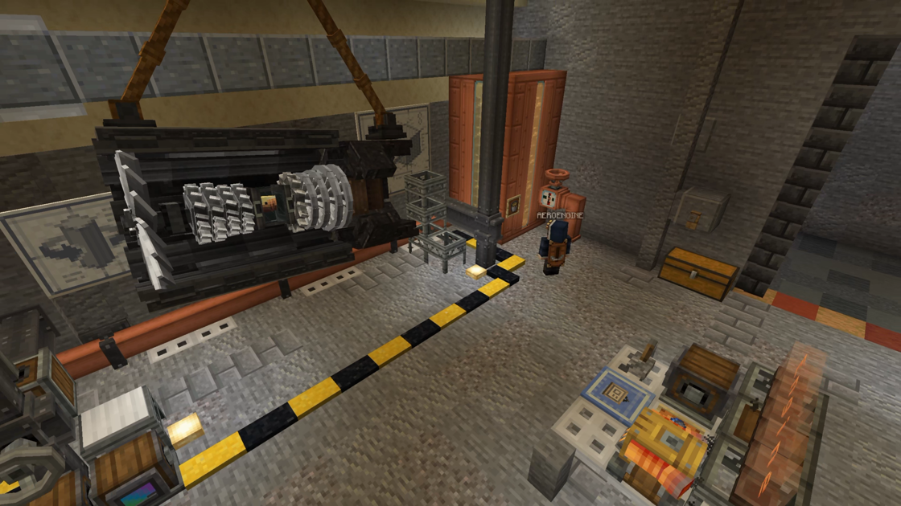

---
navigation:
  title: "Engines"
  position: 6
  parent: reference.vehicles.md
  icon: create:steam_engine
---

# Engines

 [English](https://www.youtube.com/results?search_query=Create+Propulsion+AeroEngine+engines+fuel+thrust+tutorial) · [中文](https://www.youtube.com/results?search_query=Create+Propulsion+AeroEngine+%E5%8F%91%E5%8A%A8%E6%9C%BA+%E7%87%83%E6%96%99+%E6%8E%A8%E5%8A%9B+%E6%95%99%E7%A8%8B)

## Propulsion families

<EmiSearch query="@aeroengineering" /> <EmiSearch query="@create" />

An aircraft engine workshop

### Create Propulsion

<EmiSearch query="@createpropulsion" />

<ItemGrid><ItemIcon id="createpropulsion:thruster" /><ItemIcon id="createpropulsion:vector_thruster" /><ItemIcon id="createpropulsion:solid_fuel_thruster" /><ItemIcon id="createpropulsion:ion_thruster" /></ItemGrid>

### Turbine, rocket and propeller

<EmiSearch query="@rocketnautics" />

<ItemGrid><ItemIcon id="aeroengineering:engine_fan" /><ItemIcon id="aeroengineering:engine_turbine" /><ItemIcon id="rocketnautics:rocket_thruster" /><ItemIcon id="aeronautics:propeller_bearing" /></ItemGrid>

This pack has four ways to push a body, and they are not interchangeable. Pick the family, then follow that family's own help.

| Family | Makes movement by | Needs | Fits |
| --- | --- | --- | --- |
| Propeller bearing | Rotating a sail structure into air | Rotation and sails | Airships and planes |
| Create Propulsion thruster | Expelling a fluid or burning solid fuel | Fuel and a signal | Air and space |
| AeroEngine turbine | Compressing and igniting kerosene | Built core and fuel | Fast aircraft |
| Rocket thruster | Burning liquid fuel in vacuum | Fuel tank and feed | Orbital launch |

## Create Propulsion thrusters

<ItemGrid><ItemIcon id="createpropulsion:thruster" /><ItemIcon id="createpropulsion:vector_thruster" /><ItemIcon id="createpropulsion:solid_fuel_thruster" /><ItemIcon id="createpropulsion:liquid_vector_thruster" /><ItemIcon id="createpropulsion:ion_thruster" /><ItemIcon id="createpropulsion:stirling_engine" /></ItemGrid>

A <ItemLink id="createpropulsion:thruster" /> takes a fluid and a redstone input. The 2x2 and 3x3 forms take more inputs and are built from the same block, so a cluster is a bigger engine rather than a different one.

A <ItemLink id="createpropulsion:vector_thruster" /> tilts its thrust. Each side except the front and back has a redstone input, and powering a side turns the nozzle towards that side. Signal strength from 0 to 15 sets how far it rotates from centre, which is what a joystick channel feeds. The liquid vector version adds fluid thrust to the same gimbal.

A <ItemLink id="createpropulsion:solid_fuel_thruster" /> burns solid items loaded from the rear, so it needs no pipe. The <ItemLink id="createpropulsion:ion_thruster" /> takes Forge Energy and redstone and gives low thrust for a long time, which suits station keeping rather than launch.

A <ItemLink id="createpropulsion:stirling_engine" /> is the other direction. Heat from below makes it produce rotation, so it powers a propeller or a pump instead of pushing the hull.

## Turbine core

### Engine sections

<ItemGrid><ItemIcon id="aeroengineering:engine_fan" /><ItemIcon id="aeroengineering:engine_compressor" /><ItemIcon id="aeroengineering:engine_combustor" /><ItemIcon id="aeroengineering:engine_turbine" /><ItemIcon id="aeroengineering:engine_exhaust_cone" /></ItemGrid>

### Fuel and manufacturing parts

<ItemGrid><ItemIcon id="aeroengineering:aviation_kerosene_bucket" /><ItemIcon id="aeroengineering:aviation_alloy_ingot" /><ItemIcon id="aeroengineering:aviation_alloy_sheet" /><ItemIcon id="aeroengineering:aviation_blade" /><ItemIcon id="aeroengineering:compressor_component" /><ItemIcon id="aeroengineering:turbine_component" /></ItemGrid>

The AeroEngine core stacks in one order, fan, compressor, combustor, turbine, exhaust cone. Build the core, then add the casing, nozzle, fuel feed and gearbox that the engine's own Ponder shows. A core without a fuel feed spins nothing.

<Recipe id="aeroengineering:compressor_component" />

## Fuel and where it comes from

<ItemGrid><ItemIcon id="aeroengineering:aviation_kerosene_bucket" /><ItemIcon id="createpropulsion:turpentine_bucket" /><ItemIcon id="createpropulsion:platinum_ingot" /><ItemIcon id="minecraft:lava_bucket" /><ItemIcon id="minecraft:redstone" /></ItemGrid>

| Fuel or input | Feeds | Supply it by |
| --- | --- | --- |
| Aviation Kerosene | AeroEngine turbine | Fluid pipe into the engine feed |
| Turpentine | Create Propulsion thruster | Fluid pipe or tank |
| Solid items | Solid Fuel Thruster | Loading the rear |
| Lava | Rocket thruster | Ship fluid system |
| Forge Energy and redstone | Ion thruster | Power network and signal |

The bucket icons stand for the fluid. Nothing here asks you to insert a bucket. Kerosene is also produced by Create: The Factory Must Grow, and the fuel compat addon lets AeroEngine accept it, so one oil line can supply both engine families. Refining is covered in [Oil and industry](power.industry.md).

## Thrust in this pack

<ItemGrid><ItemIcon id="aeronautics:propeller_bearing" /><ItemIcon id="aeronautics:wooden_propeller" /><ItemIcon id="aeronautics:andesite_propeller" /><ItemIcon id="aeronautics:smart_propeller" /></ItemGrid>

The pack applies separate multipliers to each component: the propeller bearing is 0.2, while wooden, andesite and smart propellers are 1.0. These multiply each component's own baseline. they are not comparable thrust ratings. Judge a design by a loaded movement test, available power and handling rather than assuming one large propeller beats several bearings.

***

## Related mods

| Mod or content | Purpose | Item search |
| --- | --- | --- |
|  [AeroEngine](vehicles.engines.md) | Adds modular aircraft engines and flight control instruments to Create. | <EmiSearch query="@aeroengineering" /> |
|  [AeroEngine fuel compat](vehicles.engines.md) | Allows AeroEngine to use kerosene from Create: The Factory Must Grow. | <EmiSearch query="@aeroengineering" /> <EmiSearch query="@tfmg" /> |
|  [Create Propulsion: Simulated](vehicles.engines.md) | Adds fuel and electric thrusters that propel Sable and Aeronautics vehicles. | <EmiSearch query="@createpropulsion" /> |
