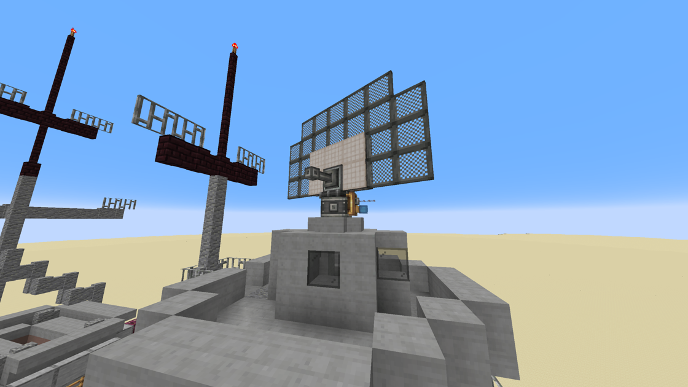

---
navigation:
  title: "Radar"
  position: 8
  parent: reference.vehicles.md
  icon: minecraft:sculk_sensor
---

# Radar

## Detection chain

<EmiSearch query="@create_radar" />

Radar antenna assemblies

<ItemGrid><ItemIcon id="create_radar:radar_bearing" /><ItemIcon id="create_radar:radar_receiver_block" /><ItemIcon id="create_radar:radar_dish_block" /><ItemIcon id="create_radar:radar_plate_block" /><ItemIcon id="create_radar:monitor" /><ItemIcon id="create_radar:data_link" /></ItemGrid>

A radar is a bearing, a receiver, a dish array and a monitor, linked in that order.

1. Place the <ItemLink id="create_radar:radar_bearing" /> and give it rotation. It sweeps the array.
2. Place the <ItemLink id="create_radar:radar_receiver_block" /> beside it.
3. Build dishes with <ItemLink id="create_radar:radar_dish_block" /> or plates with <ItemLink id="create_radar:radar_plate_block" />. Dishes and plates are interchangeable, and each added piece extends range.
4. Place a <ItemLink id="create_radar:monitor" /> where you read it, and join the two with a <ItemLink id="create_radar:data_link" />.
5. Right-click the link to configure the channel.

A sweeping bearing alone detects nothing. An array with no receiver reports nothing. The monitor shows what the receiver sends, so check the link colour before blaming the array.

## Network and filters

<ItemGrid><ItemIcon id="create_radar:network_filterer" /><ItemIcon id="create_radar:radar_filter_item" /><ItemIcon id="create_radar:target_filter_item" /><ItemIcon id="create_radar:ident_filter_item" /><ItemIcon id="create_radar:identification_transponder" /><ItemIcon id="create_radar:radar_safe_zone_designator" /><ItemIcon id="create_radar:radar_warning_receiver" /></ItemGrid>

The <ItemLink id="create_radar:network_filterer" /> is the centre of a radar network. It accepts filters that limit what the network can see and do, and it links to monitors in the same way a single radar does.

| Filter | Limits by | Fit it when |
| --- | --- | --- |
| <ItemLink id="create_radar:radar_filter_item" /> | Which contacts appear | The screen is crowded |
| <ItemLink id="create_radar:target_filter_item" /> | Which contacts can be targeted | You share airspace with allies |
| <ItemLink id="create_radar:ident_filter_item" /> | Which identities are accepted | You run transponders |

An <ItemLink id="create_radar:identification_transponder" /> on a friendly craft marks it as known. The <ItemLink id="create_radar:radar_warning_receiver" /> warns a craft that it is being tracked, and the <ItemLink id="create_radar:radar_safe_zone_designator" /> keeps a position out of the weapon network.

## Fire control

<ItemGrid><ItemIcon id="create_radar:auto_yaw_controller" /><ItemIcon id="create_radar:auto_pitch_controller" /><ItemIcon id="create_radar:fire_controller" /><ItemIcon id="create_radar:guided_fuze" /></ItemGrid>

A turret needs a yaw controller under the mount and a pitch controller beside it. Link both with data links, then select a target on the monitor. The <ItemLink id="create_radar:fire_controller" /> emits redstone when the cannon is aligned, and that signal is what actually fires the gun.

Red data links belong to a weapon network and blue data links to a radar network. Mixing the two is the usual reason a turret tracks but never fires.

<Recipe id="create_radar:crafting/auto_pitch_controller" />

## Aircraft radar

<EmiSearch query="@aeroengineering" />

<ItemGrid><ItemIcon id="aeroengineering:airborne_radar" /><ItemIcon id="create_radar:binoculars" /><ItemIcon id="create_radar:plane_radar" /></ItemGrid>

The AeroEngine <ItemLink id="aeroengineering:airborne_radar" /> is a separate instrument. It switches targets, confirms a lock and sends launch frequencies to a missile, so it belongs with the aircraft's own weapon, not with the ground radar network. <ItemLink id="create_radar:binoculars" /> identify a contact by eye when the screen is ambiguous.

***

## Related mods

| Mod or content | Purpose | Item search |
| --- | --- | --- |
|  [Create: Radars](vehicles.radar.md) | Adds radar equipment to detect and track targets in Create builds. | <EmiSearch query="@create_radar" /> |
