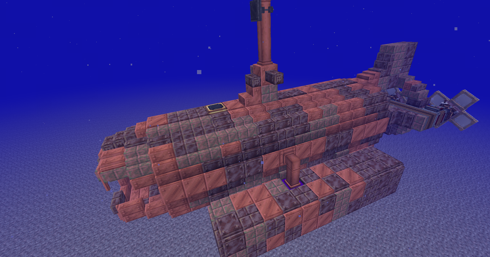

---
navigation:
  title: "Boats & submarines"
  position: 3
  parent: reference.vehicles.md
  icon: minecraft:oak_boat
---

# Boats & submarines

## Hull

<EmiSearch query="@create_submarine" /> <EmiSearch query="@starcatcher" />

Deep Seas copper submarine.

A submarine is a sealed hull built as a Simulated Contraption, then fitted with ballast, propulsion and air. Assemble it as described in [Assembly](vehicles.assembly.md). The hull decides how deep you can go, so fit the pressure glass before the first dive rather than after it.

<ItemGrid><ItemIcon id="create_submarine:floater" /><ItemIcon id="create_submarine:ballast_tank" /><ItemIcon id="create_submarine:ballast_vent" /><ItemIcon id="create_submarine:water_thruster" /><ItemIcon id="create_submarine:submarine_propeller" /><ItemIcon id="create_submarine:rudder" /><ItemIcon id="create_submarine:arresting_hook" /><ItemIcon id="create_submarine:decompression_chamber" /><ItemIcon id="minecraft:oak_boat" /><ItemIcon id="starcatcher:oak_tackle_box_boat" /></ItemGrid>

A <ItemLink id="create_submarine:floater" /> keeps a surface boat up. It is a float, not a dive control.

## Dive and rise

<Recipe id="create_submarine:ballast_tank" />

The dive system is a <ItemLink id="create_submarine:ballast_vent" />, a pump, and one or more <ItemLink id="create_submarine:ballast_tank" /> blocks, joined with pipes.

1. Place the vent so at least one face touches the sea. Without sea contact there is nothing to pump.
2. Pipe every vent face you need to the tanks, through a Mechanical Pump.
3. Pull water from the vent into the tanks to dive. The submarine gets heavier as the tanks fill.
4. Reverse the pump to push the water back out of the vent. The tanks empty and the submarine rises.

The vent itself needs no rotation and no redstone. The pump is what moves the water, so a pump with no rotation is a ballast system that does nothing. With an <ItemLink id="create_submarine:pump_controller" /> and an Onboard Computer aboard, the computer works out which way round the pipe run goes and drives the pumps to a target depth you set on its screen.

## Propulsion and steering

<ItemGrid><ItemIcon id="create_submarine:underwater_mine" /></ItemGrid>

| Part | Needs | Gives |
| --- | --- | --- |
| <ItemLink id="create_submarine:water_thruster" /> | Water pressure and rotation | Thrust that rises with both |
| <ItemLink id="create_submarine:submarine_propeller" /> | Rotation | Steady underwater drive |
| <ItemLink id="create_submarine:rudder" /> | A steering input | Turns the hull |

<ItemLink id="create_submarine:water_thruster" /> burns pressurised water for thrust and needs a water supply and rotation. More pressure and more speed mean more thrust. The <ItemLink id="create_submarine:submarine_propeller" /> is the simpler drive and works underwater, not in air. The <ItemLink id="create_submarine:rudder" /> is the steering surface.

A surface boat can use a propeller as well, but a propeller in air pushes nothing.

## Air and pressure

<EmiSearch query="@create" />

<ItemGrid><ItemIcon id="create_submarine:electrolyzer" /><ItemIcon id="create_submarine:oxygene_diffuser" /><ItemIcon id="create_submarine:barometer" /><ItemIcon id="create_submarine:copper_pressurizer" /><ItemIcon id="create_submarine:iron_pressurizer" /><ItemIcon id="create_submarine:phycological_membrane" /></ItemGrid>

| Machine | Takes | Gives |
| --- | --- | --- |
| <ItemLink id="create_submarine:electrolyzer" /> | Water and Forge Energy, or a shaft in its module slot | Oxygen |
| <ItemLink id="create_submarine:oxygene_diffuser" /> | Stored oxygen and a redstone signal | Breathable air in the sealed room |
| <ItemLink id="create_submarine:barometer" /> | Nothing | Depth and hull pressure against the weakest block |

The electrolyzer can run without an electricity network. Put a shaft in its module slot and it converts rotation into its own power, which is the route this pack expects on a Create ship. The diffuser consumes oxygen in proportion to the size of the submarine, so a large hull needs more than one, or a smaller sealed cabin.

The barometer compares outside pressure with the weakest block in the hull. Read it before you descend further, and watch it after any hull repair. Copper and iron pressurised glass are windows that hold pressure, and a <ItemLink id="create_submarine:phycological_membrane" /> can be filled with air.

## Finding the way

<ItemGrid><ItemIcon id="create_submarine:sonar" /><ItemIcon id="create_submarine:pump_controller" /><ItemIcon id="create_submarine:industrial_alarm" /><ItemIcon id="create_submarine:steel_cable" /><ItemIcon id="create_submarine:pulley" /></ItemGrid>

A <ItemLink id="create_submarine:sonar" /> maps the sea floor, rocks, other ships and mines around the hull. With an Onboard Computer on the same ship it adds map pages and lets the autopilot follow the sea floor and keep the keel clear.

Steel cable and facing pulleys carry a sublevel along a fixed line, which suits a diving bell or a cable car more than a free submarine. The <ItemLink id="create_submarine:industrial_alarm" /> warns the crew, and the underwater mine is a weapon rather than a tool.

<Recipe id="create_submarine:electrolyzer" />

***

***

## Related mods

| Mod or content | Purpose | Item search |
| --- | --- | --- |
|  [Create Deep Seas](vehicles.water.md) | Adds marine vehicle components for Aeronautics boats and submarines. | <EmiSearch query="@create_submarine" /> |
