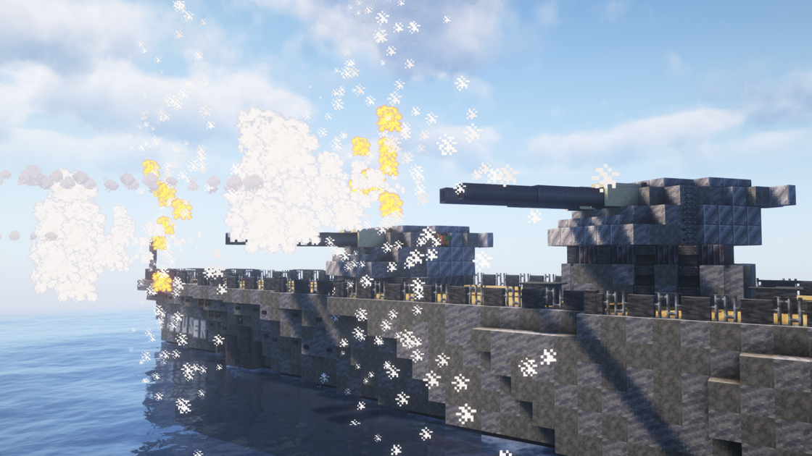

---
navigation:
  title: "Mounted weapons"
  position: 9
  parent: reference.vehicles.md
  icon: minecraft:dispenser
---

# Mounted weapons

 [English](https://www.youtube.com/results?search_query=Create+Big+Cannons+sliding+breech+muzzle+loading+cannon+mount+tutorial) · [中文](https://www.youtube.com/results?search_query=Create+Big+Cannons+%E6%BB%91%E5%8A%A8%E7%82%AE%E9%97%A9+%E5%89%8D%E8%A3%85+%E7%82%AE%E6%9E%B6+%E6%95%99%E7%A8%8B)

## Cannon assembly

<EmiSearch query="@createbigcannons" /> <EmiSearch query="@create" />

<ItemGrid><ItemIcon id="createbigcannons:cannon_mount" /><ItemIcon id="createbigcannons:steel_cannon_barrel" /><ItemIcon id="createbigcannons:steel_sliding_breech" /><ItemIcon id="createbigcannons:bronze_autocannon_barrel" /><ItemIcon id="createbigcannons:autocannon_ammo_container" /></ItemGrid>

A Big Cannon is its own assembled machine: a compatible breech, chamber and barrel mounted through <ItemLink id="createbigcannons:cannon_mount" />. This cannon-assembly step is separate from assembling the Sable vehicle carrying it. Read the cannon mount and breech Ponder lessons before loading ammunition.

| Weapon family | What belongs together | First check |
| --- | --- | --- |
| Big cannons | Matching big-cannon barrel, chamber and breech material | Complete the required processing and joining before assembly |
| Autocannons | Autocannon breech, recoil spring and autocannon barrels | Use autocannon cartridges and its ammunition container |

Bronze exists in more than one weapon family. A material name does not make an autocannon barrel interchangeable with a big-cannon barrel. Do not infer compatibility from color alone.

Start with the mount fixed on a clear test range. Open its Ponder for the assembly signal and the separate firing input. simply powering an arbitrary side is not the whole setup. Fit a proven cannon to a ship only after its mount, aim and loading cycle work. Recoil behavior is weapon-specific: the mounted potato cannon setting does not establish Big Cannons recoil.

## Loading and firing

 [English](https://www.youtube.com/results?search_query=Create+Big+Cannons+sliding+breech+loading+ramrod+tutorial) · [中文](https://www.youtube.com/results?search_query=Create+Big+Cannons+%E6%BB%91%E5%8A%A8%E7%82%AE%E9%97%A9+%E6%8E%A8%E5%BC%B9%E5%99%A8+%E8%A3%85%E5%A1%AB+%E6%95%99%E7%A8%8B)

<Recipe id="createbigcannons:ap_shot" />

Loading depends on the breech. For the sliding-breech big cannon shown above, use its barrel-side loading procedure: place the projectile ahead of the propellant, with the propellant behind the projectile toward the breech. Ram the load into its firing position, close the breech and use the mount's firing input. Do not treat every breech as an opening through which charge and shell can be inserted in the same order.

Start with a modest compatible charge on a clear range. If it will not fire, check that the cannon is assembled, the breech is closed, the load is seated and the mount receives its firing input. Do not fix a misfire by adding more propellant.

<ItemLink id="createbigcannons:autocannon_ammo_container" /> holds autocannon cartridges. Load and attach it using the autocannon breech interaction. it is not a belt of big-cannon shells.

## Ammunition

<EmiSearch query="@create_radar" />

<ItemGrid><ItemIcon id="createbigcannons:ap_shell" /><ItemIcon id="createbigcannons:ap_shot" /><ItemIcon id="createbigcannons:bag_of_grapeshot" /><ItemIcon id="createbigcannons:big_cartridge" /><ItemIcon id="create_radar:guided_fuze" /></ItemGrid>

| Round | Job | Target |
| --- | --- | --- |
| <ItemLink id="createbigcannons:ap_shell" /> | Pierces armour | Armoured ships and blocks |
| <ItemLink id="createbigcannons:ap_shot" /> | Solid impact | Structures |
| <ItemLink id="createbigcannons:bag_of_grapeshot" /> | Spread at short range | Crew and light craft |
| <ItemLink id="createbigcannons:big_cartridge" /> | propellant, not a projectile | Load behind a separate compatible projectile |

Match the round to the bore. A shell that does not fit the barrel is a shell you cannot load, and the recipe browser shows which family each round belongs to.

## Aircraft weapons

<EmiSearch query="@aeroengineering" />

<ItemGrid><ItemIcon id="aeroengineering:missile_assembly_station" /><ItemIcon id="aeroengineering:air_to_air_missile" /><ItemIcon id="aeronautics:mounted_potato_cannon" /></ItemGrid>

AeroEngine supplies a <ItemLink id="aeroengineering:missile_assembly_station" /> and an <ItemLink id="aeroengineering:air_to_air_missile" />. The missile is fired from the aircraft radar lock, so build the station before you plan an intercept.

The <ItemLink id="aeronautics:mounted_potato_cannon" /> is the light option. Its recoil is a pack setting of 0.2, which is enough to nudge a small hull and not enough to stop a large one.

## Aiming

<ItemGrid><ItemIcon id="create_radar:auto_yaw_controller" /><ItemIcon id="create_radar:auto_pitch_controller" /><ItemIcon id="create_radar:fire_controller" /></ItemGrid>

Point the gun with a yaw and pitch controller from [Radar](vehicles.radar.md), and let the fire controller pull the trigger when the barrel is on target. Firing by hand from a moving deck works, but the shot inherits the ship's motion.

***

***

## Related mods

| Mod or content | Purpose | Item search |
| --- | --- | --- |
|  [Create Big Cannons](vehicles.weapons.md) | Adds buildable large cannons and their ammunition to Create. | <EmiSearch query="@createbigcannons" /> |
