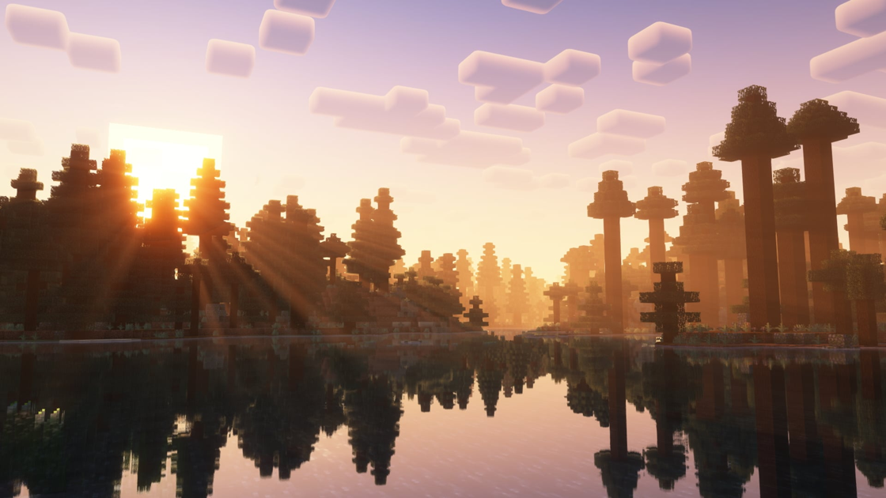

---
navigation:
  title: "Lighting & distance"
  position: 5
  parent: reference.appearance.md
  icon: minecraft:lantern
---

# Lighting & distance

## Shader compatibility

<EmiSearch query="@create" />

Complementary Reimagined landscape

Iris Flywheel Compat connects Iris shaders with optimized Flywheel rendering for Create machinery. Iris Veil Compat connects Iris with Veil effects used by Aeronautics and Sable. These are client rendering bridges, not extra shader styles or server gameplay features.

Fresh installations select Complementary Reimagined but leave shaders disabled. Enable a shader deliberately in Iris, then inspect both machinery and ship effects. Existing player settings are preserved. The Veil bridge is an alpha release, so compatibility support is not a guarantee that every shader effect renders correctly.

***

## Shaders & distance

Iris loads shader packs. Distant Horizons displays simplified distant terrain. These are separate systems.

Fresh installations enable adaptive Distant Horizons transfer speed, which adjusts terrain-data transfer to client performance. This does not set render distance or speed up terrain generation. Existing player settings are preserved.

| Component | Function |
| --- | --- |
| Distant Horizons | Displays simplified terrain beyond ordinary render distance. |
| Iris Shaders | Loads shader packs. |

***

## Dynamic lighting

<EmiSearch query="@spawn" />

Sodium Dynamic Lights and its Create and Sable bridge are heavy edition only. Dynamic lighting is a visual effect, not a guarantee of server-side spawn prevention.

| Component | Function |
| --- | --- |
| Create Sable Dynamic Lights (heavy edition only) | Extends dynamic lighting to Create and Sable structures. |
| Sodium Dynamic Lights (heavy edition only) | Provides dynamic lighting with Sodium settings integration. |

***

## Related topics

- [Shader styles](visuals.shader-packs.md)
- [Video options](visuals.interface.md)
- [Light & spawning](building.safety.md)

***

## Related mods

| Mod or content | Purpose | Item search |
| --- | --- | --- |
| <ItemImage id="minecraft:painting" /> [Create Sable Dynamic Lights](visuals.lighting.md) (heavy edition only) | Adds dynamic light support for lights on Create and Sable moving structures. | No separate item search |
|  [Distant Horizons](visuals.lighting.md) | Displays simplified terrain beyond ordinary render distance. | No separate item search |
|  [Iris & Oculus Flywheel Compat](visuals.lighting.md) | Bridges Iris shaders and Flywheel machine rendering. | No separate item search |
|  [Iris Shaders](visuals.lighting.md) | Loads shader packs. | No separate item search |
|  [Iris Veil Compat](visuals.lighting.md) | Bridges Iris shaders and Veil rendering effects. | No separate item search |
| <ItemImage id="minecraft:painting" /> [Sodium Dynamic Lights](visuals.lighting.md) (heavy edition only) | Provides dynamic lighting with Sodium settings integration. | No separate item search |
