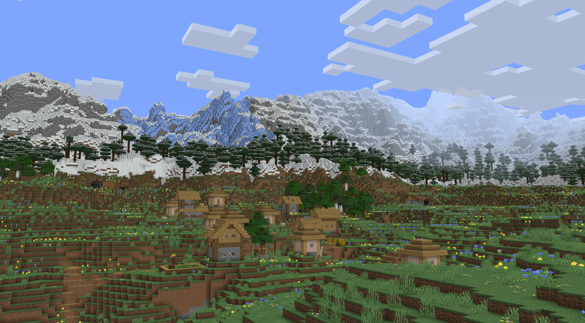
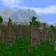
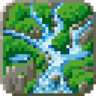
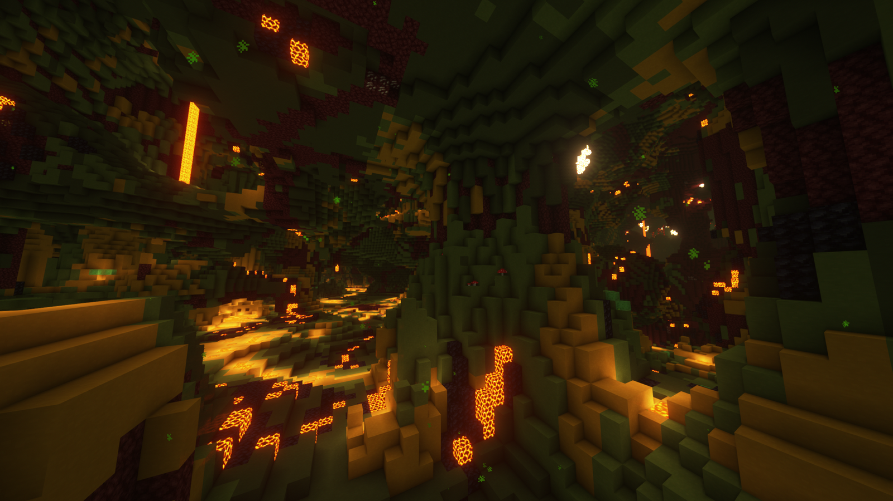
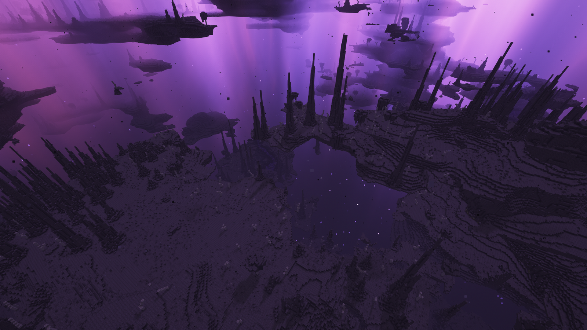
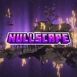

---
navigation:
  title: "Dimensions"
  position: 5
  icon: minecraft:grass_block
---

# Dimensions

## Overworld

Tectonic shapes larger landforms, Terralith adds surface and cave biomes built from vanilla blocks, and Streams Reflowing adds flowing streams.

| Terrain | Contribution |
| --- | --- |
|  Tectonic | Mountain ranges and large landforms |
|  Terralith | Surface and cave biomes |
|  Streams Reflowing | Flowing streams |

### Terralith biomes

| Biome | Biome | Biome |
| --- | --- | --- |
| Alpha Islands | Alpha Islands Winter | Alpine Grove |
| Alpine Highlands | Amethyst Canyon | Amethyst Rainforest |
| Ancient Sands | Arid Highlands | Ashen Savanna |
| Basalt Cliffs | Birch Taiga | Blooming Plateau |
| Blooming Valley | Brushland | Bryce Canyon |
| Caldera | Caves: Andesite Caves | Caves: Deep Caves |
| Caves: Diorite Caves | Caves: Frostfire Caves | Caves: Fungal Caves |
| Caves: Granite Caves | Caves: Infested Caves | Caves: Mantle Caves |
| Caves: Thermal Caves | Caves: Tuff Caves | Caves: Underground Jungle |
| Cloud Forest | Cold Shrubland | Deep Warm Ocean |
| Desert Canyon | Desert Oasis | Desert Spires |
| Emerald Peaks | Forested Highlands | Fractured Savanna |
| Frozen Cliffs | Glacial Chasm | Granite Cliffs |
| Gravel Beach | Gravel Desert | Haze Mountain |
| Highlands | Hot Shrubland | Ice Marsh |
| Jungle Mountains | Lavender Forest | Lavender Valley |
| Lush Desert | Lush Valley | Mirage Isles |
| Moonlight Grove | Moonlight Valley | Orchid Swamp |
| Painted Mountains | Red Oasis | Rocky Jungle |
| Rocky Mountains | Rocky Shrubland | Sakura Grove |
| Sakura Valley | Sandstone Valley | Savanna Badlands |
| Savanna Slopes | Scarlet Mountains | Shield |
| Shield Clearing | Shrubland | Siberian Grove |
| Siberian Taiga | Skylands Autumn | Skylands Spring |
| Skylands Summer | Skylands Winter | Snowy Badlands |
| Snowy Cherry Grove | Snowy Maple Forest | Snowy Shield |
| Steppe | Stony Spires | Temperate Highlands |
| Tropical Jungle | Valley Clearing | Volcanic Crater |
| Volcanic Peaks | Warm River | Warped Mesa |
| White Cliffs | White Mesa | Windswept Spires |
| Wintry Forest | Wintry Lowlands | Yellowstone |
| Yosemite Cliffs | Yosemite Lowlands |  |

***

## Nether

Incendium Legacy reshapes the Nether. Incendium Biomes Only keeps its terrain and biomes but removes its added structures, items, creatures and bosses.

### Incendium biomes

| Biome | Biome | Biome |
| --- | --- | --- |
| Ash Barrens | Infernal Dunes | Inverted Forest |
| Quartz Flats | Toxic Heap | Volcanic Deltas |
| Weeping Valley | Withered Forest |  |

***

## End

Nullscape reshapes the End's outer islands. It changes an existing dimension rather than adding another portal destination.

### Nullscape biomes

| Biome | Biome | Biome |
| --- | --- | --- |
| Crystal Peaks | Shadowlands | Void Barrens |

***

## Space destinations

<EmiSearch query="@rocketnautics" /> <EmiSearch query="@rocketnautics_addon" /> <EmiSearch query="@create" />

Cosmonautics adds a landable Moon dimension. Create Cosmonautics Expansion adds a landable Mars dimension with plains, frostlands and underground caves. Both have planetary records linked to their playable dimensions.

| Destination | What to expect |
| --- | --- |
| Moon | Lunar highlands, maria and chasms |
| Mars | Plains, frostlands and underground caves |

Deep Space is the transit dimension used by orbital ships, not a planetary surface. The base mod's gas giant and ice world records describe celestial bodies, but do not link to landable dimensions.

- [Space destinations](space.destinations.md) The included landing worlds and how the orbital route relates to them.
- [Orbital flight](space.vehicle-transfer.md) Building and flying a physical spacecraft to space.

***

## Getting started

| Destination | Access |
| --- | --- |
| Overworld | The starting world |
| Nether | Light an obsidian portal |
| End | Activate a stronghold's End portal with <ItemLink id="minecraft:ender_eye" /> |
| Moon and Mars | Use the orbital flight system described in [Orbital flight](space.vehicle-transfer.md) |

Terrain changes appear in newly generated areas. Opening this guide does not rebuild existing terrain.

- [Location finders](maps.find.md)

***

## Related mods

| Mod or content | Purpose | Item search |
| --- | --- | --- |
| <ItemImage id="minecraft:minecart" /> [Create Cosmonautics](space.destinations.md) | Adds orbital flight, the Moon, rocket and breathing equipment, and a planetary display. | <EmiSearch query="@rocketnautics" /> |
| <ItemImage id="minecraft:minecart" /> [Create Cosmonautics Expansion](space.navigation.md) | Adds the landable Mars dimension, terrain and planetary record. | <EmiSearch query="@rocketnautics_addon" /> |
|  [Incendium Biomes Only](world.dimensions.md) | Keeps Incendium terrain and biomes while removing its structures, creatures and items. | No separate item search |
|  [Incendium Legacy](world.dimensions.md) | Overhauls Nether biomes and adds structures, enemies and unique equipment. | No separate item search |
|  [Nullscape](world.dimensions.md) | Reshapes the End with alien terrain and additional biomes. | No separate item search |
|  [Streams Reflowing](world.dimensions.md) | Generates flowing streams in world terrain. | No separate item search |
|  [Tectonic](world.dimensions.md) | Reshapes terrain with larger mountains and varied landforms. | No separate item search |
|  [Terralith](world.dimensions.md) | Adds surface and cave biomes built from vanilla blocks. | No separate item search |
